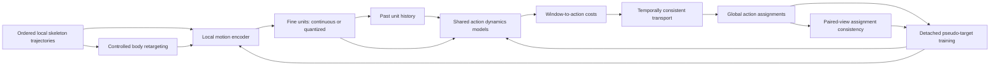

# Learning reusable motion units through compositional action dynamics

Research proposal · 5 October 2026 · Version 1

**Status:** proposed architecture and evaluation programme; not an implemented experiment. Phase 9 is still being completed. This document does not infer its final outcome from partial artifacts.

## 1. The research bet

**Central hypothesis:** actions are more consistently recovered across recordings when represented by the ordered motion evolution they explain, rather than solely by proximity to one embedding centroid. Fine movement units should be reusable across actions and across controlled changes in body realization.

The proposed system learns short-support motion representations and shared action models over their sequences. Transport infers temporally coherent action assignments and supplies training targets. Controlled body retargeting tests and trains consistency of those assignments. Action models can contain many units, and a unit can participate in many actions: there is no fixed code-to-action lookup.

The intended contribution is a **coupled learning and inference mechanism for body-consistent composition of local motion units**. It must demonstrate both competitive segmentation and the claimed mechanism. A larger Transformer, a second codebook, ordinary OT self-training, or a generic predictive objective would not establish that contribution independently.

This is a research hypothesis with a plausible path to a strong paper, not an established novelty claim or a prediction of CVPR acceptance. A focused comparison with switching dynamics, hierarchical motion representations, and joint alignment/segmentation is an implementation prerequisite. It should take place alongside development, rather than expand into another long experimental programme.

## 2. What the current experiments establish

The current best recipes provide useful initial features and executable controls. They do not establish that reconstruction-trained latents are universally harmful, that discrete units are intrinsically unsuitable, or that subject identity is the principal cause of failure.

| Observation | What it motivates | What it does not establish |
| --- | --- | --- |
| Raw relational T2 features remain competitive with the learned alternatives examined so far. | Preserve a fixed-feature reference and retain relational geometry when training the new encoder. | That representation learning cannot improve the task. |
| Contextualization helps some token families; masked prediction loss has not reliably tracked segmentation. | Give learning an objective that involves global action discovery and test order directly. | That a particular context model is optimal or that its units are semantic movemes. |
| Q1/Q2 found substantial subject association, including conditional on action. | Examine nuisance-sensitive target construction and geometry. | That raw subject/action MI measures competing fractions of a fixed information budget. |
| Phase 9 BABEL layer-2 clusters are more associated with recording than T2 codes. | Test whether iterative target refinement reinforces recording-specific structure. | That the extra association is anatomical identity or causes the score changes. |
| Per-recording normalization reduces subject association but does not uniformly improve segmentation. | Preserve action-relevant information while controlling nuisances, rather than suppress all recording variation. | That stronger normalization will solve discovery. |

Evidence and provenance:

- [Q1/Q2 report](../../results/exp2round/q1q2/REPORT.md), especially information diagnostics and the raw/per-recording controls.
- [Phase 9 design](week5/TIMESCALE_INSPECTION/PHASE9_LEARNED_UNITS.md), including its limits on local-unit claims.
- [Phase 9 BABEL-2 diagnostic, seed 111](../../results/week5/timescale_inspection/ts5_v2/phase9/diagnostics/babel2__seed111.json): layer-2 recording NMI 0.740 versus T2 0.620; same-recording neighbour share 0.491 versus 0.326.
- [Phase 9 BABEL-3 diagnostic, seed 111](../../results/week5/timescale_inspection/ts5_v2/phase9/diagnostics/babel3__seed111.json): corresponding values 0.768 versus 0.610 and 0.670 versus 0.450.

**Diagnostic correction:** the current neighbour test excludes eight windows, whereas contextual inference uses overlapping 128-window chunks. Nearby eligible embeddings can still share their input support. Repeat the diagnostic with non-overlapping actual receptive supports and action-matched, recording-balanced candidates before interpreting the increase as identity amplification. These are inexpensive saved-model checks, not a reason to postpone architectural work.

## 3. Where the ideas come from

The following distinguishes established ingredients from adaptations and proposed contributions. Summaries describe the cited methods; their success on their original tasks is not evidence that the adaptation will work here.

| Source | Established ingredient | What this proposal takes or changes |
| --- | --- | --- |
| [SMQ, ICCV 2025](https://openaccess.thecvf.com/content/ICCV2025/papers/Gokay_Skeleton_Motion_Words_for_Unsupervised_Skeleton-Based_Temporal_Action_Segmentation_ICCV_2025_paper.pdf) | Patch-level skeleton quantization learned through reconstruction. | Retain local discrete representations as an option. Replace the assumption that reconstruction alone will produce suitable action evidence. |
| [HiST-VQ, 2026](https://arxiv.org/abs/2604.15196) | Subaction/action quantization with skeleton and timestamp reconstruction. | This occupies hierarchical quantization as a claim. Our proposed action state is a sequence model, not an additional nearest-centroid codebook. |
| [HuBERT, 2021](https://arxiv.org/abs/2106.07447) | Offline cluster targets and masked prediction from continuous inputs. | Use cluster teachers to bootstrap local units. Iterative contextual clustering is a reference, not the proposed innovation. |
| [ContentVec, ICML 2022](https://proceedings.mlr.press/v162/qian22b.html) | Address speaker dependence in both targets and learned representations. | Adapt the principle that nuisance control must involve teacher construction as well as the student. Skeleton retargeting and restricted body conditioning require their own validation. |
| [ASOT, CVPR 2024](https://arxiv.org/abs/2404.01518) | Temporally consistent unbalanced OT and pseudo-label self-training. | Reuse the solver and its temporal prior initially. Supply costs from action dynamics; train the representation through inferred assignments. OT self-training itself is borrowed. |
| [CLOT, ICCV 2025](https://openaccess.thecvf.com/content/ICCV2025/papers/Bueno-Benito_CLOT_Closed_Loop_Optimal_Transport_for_Unsupervised_Action_Segmentation_ICCV_2025_paper.pdf), [D-CLOT, 2026](https://arxiv.org/abs/2608.05877) | Coupled frame/segment learning; D-CLOT additionally stabilizes geometry and refreshes prototypes. | Establish strong closed-loop controls. Our proposed distinction is sequence-based action evidence with body consistency, not simply feedback or refreshed prototypes. |
| [VASOT, ICCV 2025](https://openaccess.thecvf.com/content/ICCV2025/papers/Ali_Joint_Self-Supervised_Video_Alignment_and_Action_Segmentation_ICCV_2025_paper.pdf) | Joint video alignment and action segmentation through OT. | Cross-recording correspondence is already studied. Controlled paired retargetings provide known temporal correspondence and a specific nuisance intervention; arbitrary cross-video alignment is not claimed as new. |
| [PACE, IJCAI 2022](https://www.ijcai.org/proceedings/2022/198) | Predictive and contrastive embeddings for unsupervised segmentation. | Predictive representation learning is prior art. The proposed action models must affect inference and demonstrate sequence composition beyond this ingredient. |
| [Keypoint-MoSeq, Nature Methods 2024](https://www.nature.com/articles/s41592-024-02318-2) | Infer behavioral states through pose dynamics while modelling observation noise. | Dynamics-defined states are prior art. We investigate shared discrete composition and body-consistent transport for human action classes; a switching predictor alone is insufficient novelty. |
| [Action Motifs / A4Mer, CVPR 2026](https://openaccess.thecvf.com/content/CVPR2026/html/Kinoshita_Action_Motifs_Self-Supervised_Hierarchical_Representation_of_Human_Body_Movements_CVPR_2026_paper.html) | Hierarchical movement atoms and motifs learned through latent prediction. | Reusable temporal compositions are also prior art. We require explicit action segmentation, shared action-state inference, and tests of the proposed nuisance intervention. |
| [LAPS, CVPR 2026](https://openaccess.thecvf.com/content/CVPR2026/papers/Zhang_From_Observation_to_Action_Latent_Action-based_Primitive_Segmentation_for_VLA_CVPR_2026_paper.pdf) | Motion tokenization and latent-energy-based primitive segmentation. | Keep quantized vectors available as geometric representations. Energy-based boundary detection is a comparison, not our principal mechanism. |
| [MASQ, 2026](https://arxiv.org/abs/2608.29891) | Structured joint dropout and mask-aware velocity consistency. | Include a strong skeleton baseline and avoid treating its changes as merely cosmetic. Its objective addresses spatial inference/temporal smoothing conflicts. |

**Novelty obligation:** show that jointly learning sequence-based action evidence and controlled body consistency provides an advantage that the individual ingredients and strong closed-loop baselines do not explain. A skeleton adaptation of an existing method is not automatically a new general method.

## 4. Architecture and information flow

### 4.1 Ordered local inputs

Use the existing datasets and data loaders. The skeleton track comprises BABEL and LARa. HuGaDB is IMU data: it requires an independently specified sensor input adapter and cannot support body-retargeting claims.

Start from the established token grid: BABEL 8 frames at 30 Hz; LARa 12 at 50 Hz; HuGaDB 15 at 60 Hz if included. These are observation supports, not inferred action durations. Preserve every evaluation frame and record terminal-window handling.

The learned skeleton encoder receives ordered within-window trajectories, including relational geometry and signed displacement. Preserve posture and useful reference-frame information. Do not presume that gravity, heading, left/right reflection, or speed are nuisances: previous feature experiments and action semantics make those assumptions unsafe.

Retain the current T2 features as a fixed reference and, initially, a residual input pathway. This makes it possible to learn additional motion information without silently discarding the successful baseline. A matched learned-only ablation determines whether that pathway is still necessary.

### 4.2 Local units

The local encoder has strictly bounded, documented support. Its unit at time t may depend on frames in its own observation window, but not on an entire recording or an inferred ground-truth segment. Contextual action states must be saved separately from these local units.

For feasibility, use the existing vocabulary and continuous features. For the learned representation, use a shared fixed teacher to bootstrap units from canonical local motion descriptors. Canonical descriptors must retain dynamic posture; body-length canonicalization alone is not an action representation.

A first compact implementation can use a 128-wide local encoder and K=512 teacher targets, with a continuous arm of the same width. These are starting engineering settings, not experimentally optimal values. Reuse the established training infrastructure and benchmark memory/time before assigning a full budget.

Learned VQ is a subsequent implementation of the same local-unit interface. Its loss must include the proposed motion/consistency objectives. FSQ is an optional matched alternative after those objectives show value; neither a quantizer choice nor codebook occupancy should decide the architecture. Always retain a continuous control and distinguish native learned codes from K-means of learned latents.

Keep bootstrap targets and emitted units distinct. The minimum fixed-unit model observes its frozen teacher codes at both fitting and inference. A native learned-code model must construct its action costs from its own emitted codes at inference; bootstrap labels may supervise an auxiliary training head but cannot provide an extra inference channel. Freeze the codebook within an assignment-update block, and refresh codes and action-model targets together at declared boundaries. A continuous model needs an explicitly specified observation likelihood over its available vectors, with controlled covariance/scale; the categorical equation below must not silently be applied to continuous vectors. These likelihood contracts are part of the execution brief.

### 4.3 Shared action dynamics

There are C latent action states, matching the benchmark's declared class-count protocol. Each state has a small action-specific dynamics adapter on a shared causal history network. The adapters predict the observed current unit from previous units. They do not receive the current target through an input bypass.

For example, reaching upward and lowering a hand may visit similar poses but have different ordered transitions. A shared unit can participate in both, while their action models predict different trajectories. This is the intended representational advantage, not an assertion that those examples will be recovered without labels.

Use one-step evidence in the minimum model. Fix an initial short history in physical time, independently of annotated durations; document the exact token conversion. A candidate starting support is approximately two seconds, with a matched half/double-support sensitivity only after feasibility. The support limits evidence; it does not prescribe segment length. Do not add an adaptive-context module in the first version.

Static actions require sustained-pose evidence. A velocity-only objective or unrestricted copy predictor can make sitting and standing indistinguishable to the action state. Therefore include a matched action-specific occupancy term as well as conditional transition evidence.

### 4.4 Minimum transport cost

For a fixed teacher unit c_t and past history H_t, define:

\[
D_{t,a}=\alpha[-\log p_a(c_t)]+(1-\alpha)[-\log p_a(c_t\mid H_t)].
\]

The occupancy model describes local configurations associated with a state; the conditional model describes their ordered evolution. Both are learned without action labels. Assign the cost to the **current observed window t**, not the preceding window, to avoid a one-token alignment shift.

This is a proposed discrete likelihood cost, not a claim that ASOT's cosine-calibrated coefficients transfer unchanged. Before the full run, declare a label-free cost normalization, temperature and temporal-coefficient policy based on training costs. Apply it equally to matched categorical and sequence controls. Save raw/scaled cost distributions and sensitivity to the declared scale. Do not choose the policy from evaluation F1.

Use the verified ASOT solver and unbalanced marginal treatment initially. It supplies temporal consistency; the likelihood models supply action evidence. Changing the temporal kernel or adding a new duration prior simultaneously would obscure the central comparison.

Two cautions matter:

- Subtracting a common predictor's loss from every action cost in the same row does not change relative action preferences; with fixed row mass it adds only a constant to the transport objective. Predictive gain over a copy/shared predictor is a diagnostic, not a nuisance-removal mechanism by itself.
- Several dynamics models can explain the same observations. Useful segmentation and semantic alignment are empirical requirements; the objective cannot guarantee identifiability of human action categories.

## 5. Body consistency and nuisance conditioning

Construct paired skeleton sequences by changing plausible bone lengths while preserving joint rotations, motion order and temporal correspondence. Use a verified kinematic tree and forward kinematics; do not independently rescale arbitrary joint coordinates. Begin with bounded perturbations inside the observed training range. If the supplied skeleton convention does not permit a trustworthy transformation, stop this arm and document the limitation.

Estimate a reference body from fitting data only. Teacher targets for both views must use the same canonicalization, fitted transforms and vocabulary. Independently clustering the views would introduce code permutations and undermine the consistency objective. Test whether the teacher itself is stable under retargeting before asking the student to agree.

The desired agreement is over local-unit probabilities and the shared action assignment at corresponding times. It should not force raw coordinates or all latent channels to be identical. Transport plans from the two views share action-state columns, so correspondence is tested without a new per-view Hungarian remapping.

A restricted body descriptor can condition an auxiliary raw-motion prediction branch, allowing the system to explain physical realization without routing body identity directly into action costs. Use static geometric measurements, not a trainable recording-ID lookup or an unconstrained pooled recording embedding. The canonical action dynamics cost remains the primary inference evidence.

This design does not remove personal style automatically. Style can be correlated with action, and some body changes can alter feasible movements or contacts. Do not use time warping, reflection or speed changes as action-preserving augmentations without separate justification. Synthetic retargeting is an intervention on geometry, not proof of transfer to real unseen people.

## 6. Learning procedure

Use alternating inference and gradient updates with transport assignments detached. This is coupled training through pseudo-targets; it is not differentiation through the OT solver.

1. Prepare fixed-feature references and verify action-free fitting populations.
2. Bootstrap local units from a fixed teacher. Keep the teacher fixed during the first sequence-model experiment so target drift cannot explain its result.
3. Warm-start action assignments from the verified fixed-feature decoder, then initialize action-specific occupancy/dynamics models from those assignments. Also retain an initialization sensitivity; warm starts can reinforce existing errors.
4. Recompute transport plans from current model costs on unmasked recordings or declared training chunks.
5. Update the action models with soft assignment-weighted unit likelihood. Train the local encoder with teacher prediction and the student action head with detached transport targets.
6. Add paired-view unit/action consistency when its geometric and teacher gates pass. Prevent trivial agreement through the predictive targets and monitored unit/state diversity.
7. Refresh assignments on a declared cadence. Save assignments, models and cost traces before each refresh. Use a fixed update budget and label-free checkpoint rule; never stop or refresh because evaluation F1 improved.

An outline objective is:

\[
\mathcal L=\mathcal L_{\text{teacher}}+\lambda_{\text{dyn}}\sum_{t,a}\operatorname{sg}(Q_{t,a})D_{t,a}
+\lambda_{\text{state}}\mathcal L_{\text{pseudo-state}}
+\lambda_{\text{view}}\mathcal L_{\text{paired consistency}}.
\]

Here sg denotes stop-gradient. Weights, cost scaling, history support, warm-start policy and refresh cadence must be declared before the first scored development run. This proposal specifies the mechanism; the exact configuration belongs in the subsequent execution brief after timing and numerical checks.

For a hard-code feasibility model, action-model gradients do not train the tokenizer through integer lookups. The learned version must use soft unit probabilities or an explicitly documented straight-through quantizer, and verify gradient flow. Claims of joint learning require that check. Continuous features must not enter a nominally discrete action arm through an undeclared side channel.

## 7. Why this could work, and what would falsify the rationale

| Proposed advantage | Reason it could help | Required evidence or falsifier |
| --- | --- | --- |
| Sequence-based action identity | A single action can span several poses and units; order can distinguish overlapping pose sets. | Beat occupancy/centroid controls and lose that advantage when local order is destroyed. |
| Cross-body reuse | Explicit paired supervision makes changes in body realization less useful for separating action states. | Stable paired assignments and improved real subject-disjoint performance; synthetic consistency alone is insufficient. |
| Relevant learned representation | Training targets involve local motion and global action inference, rather than only reconstruction or original-code predictability. | Joint learning beats the identical fixed-feature dynamics decoder. |
| Less code-to-action restriction | Units are observations of an action process, not action labels. | Demonstrate units shared across action states and distinct state-specific transitions. |
| Variable segment duration | The same dynamics state can persist while units change, without prescribing a segment length. | Gains across short/long actions and varied speeds without tuning a duration parameter from labels. |
| Preserve useful information | Relational inputs, posture evidence and a continuous control protect against repeating the information-loss problem. | Learned discrete and continuous comparisons reveal what the bottleneck removes. |

The likely early failures are action adapters converging to the same copy model, phase-level states replacing action states, and self-training reinforcing a bad initial partition. None is solved by merely increasing model size.

## 8. Probable failures and safeguards

| Failure | Observable signature | Response built into the design |
| --- | --- | --- |
| Action state is ignored | Shuffling or swapping action adapters barely changes likelihood; heads predict alike. | Limit shared predictor capacity, retain occupancy evidence, compare to copy and action-free predictors. Report failure rather than interpreting good loss as discovery. |
| States represent gait phases or speed bands | Frequent switches within a labelled action; global mapping worsens despite good prediction. | Examine within-action state transitions; compare to a switching-dynamics baseline and the same temporal regularizer. Do not tune stickiness to annotated durations. |
| Static actions merge | Standing/sitting errors grow as dynamic prediction improves. | Preserve posture/occupancy evidence and report static-class recall. |
| Boundary evidence is contaminated by history | New actions inherit the preceding state's prediction for several windows. | Measure boundary lag and evaluate support sensitivity; first use current-window likelihood with strictly past conditioning. |
| Unit or state collapse | Low occupancy/entropy, near-identical outputs, consistency loss becomes trivially small. | Keep teacher prediction and action likelihood active; monitor diversity and use declared collapse controls without imposing unrealistic uniform action frequencies. |
| Retargeting changes semantics | Contacts or poses become implausible; gains depend on extreme synthetic bodies. | Verify kinematics, bound perturbations, preserve time/angles and validate real subject transfer separately. |
| Teacher preserves nuisance | Paired target disagreement remains high. | Repair or invalidate target construction; a student-only invariance penalty is not an adequate workaround. |
| Warm-start confirmation | Different initial partitions produce incompatible solutions; errors persist. | Save initial/final assignments and compare a declared alternative initialization. |
| Quantizer harms useful dynamics | Continuous model wins while codes collapse or discard transition distinctions. | Keep the continuous arm; make native-code claims only if direct code inference is competitive. |
| Marginal/scaling assumptions drive gains | Results change sharply with cost normalization or occupancy balance. | Matched emission-scale controls, raw trace storage and declared coefficient sensitivity. |
| Action semantics are not observable | Motions with different goals have indistinguishable skeleton trajectories. | State the modality limit. Do not claim recovery of intentions or object interactions absent from inputs. |
| Small training population overfits | Validation deteriorates and held-out people fail despite pooled gains. | Use fixed validation populations, bounded capacity and prospective evaluation. Larger pretraining is a later decision, not an assumed resource. |

## 9. Evaluation required for a substantial contribution

### 9.1 Matched architecture comparisons

The minimal causal comparison ladder is:

| Arm | Representation | Action evidence | Purpose |
| --- | --- | --- | --- |
| B0 | Existing T2/contextual reference | Existing centroid ASOT | Historical executable anchor. |
| B1 | Same features; matched training budget | Centroid OT self-training | Test the benefit of ordinary closed-loop learning. |
| M1 | Same fixed unit features | Occupancy plus ordered dynamics | Isolate action composition before changing the encoder. |
| M2 | Learned local representation | Same dynamics and transport | Test learned representation under the new objective. |
| M3 | M2 with validated paired body consistency | Same dynamics and transport | Test the proposed cross-body mechanism. |

The discrete versus continuous comparison must use the same backbone, training exposure, local support and transport policy. A learned-VQ control is necessary for a claim about native discrete units; FSQ is optional unless that claim specifically concerns FSQ. No automatic three-seed grid is needed for the first feasibility check. Confirm the frozen selected method and decisive controls with at least three seeds later.

### 9.2 External comparisons

Compare with SMQ, HiST-VQ and MASQ under the same datasets, class count, frame populations and scoring conventions. Include ASOT self-training and a credible D-CLOT-style closed-loop control on the available skeleton features. A reimplementation is labelled as such and must pass relevant reproduction checks; do not invent a score for an unavailable baseline.

D-CLOT's published video scores are not numerically comparable to skeleton benchmark scores. Its published per-video/activity-level mappings must not be equated with the dataset-global mapping used here. Report the same global evaluator for local comparisons.

For mechanism claims, compare to a tractable switching-dynamics model and a predictive embedding control; otherwise gains could be explained by established predictive segmentation.

### 9.3 Decisive ablations and metrics

- Primary segmentation endpoints: global-mapping F1@50 and frame MoF, with Edit and F1@10/25/50 retained. Report class support, static-class recall, boundary lag, segment counts and duration strata.
- Destroy local unit order while preserving each sequence's unit multiset. Restore predictions to original time positions before scoring. Report this as distribution-shift sensitivity; also train a matched order-agnostic model, which is the stronger architectural control.
- Replace action-specific dynamics with occupancy-only evidence, holding the rest fixed.
- Remove paired consistency with the same augmentation exposure, separating the loss effect from extra training data.
- Compare a fixed teacher with the declared learned-unit model; do not infer moveme semantics from occupancy or prediction accuracy.
- Evaluate paired retargeted assignments without independently remapping state IDs. On real datasets, evaluate transfer or subject-disjoint performance where identifiers are reliable.
- Measure recording preference with disjoint contextual input supports, and action-matched retrieval. Report unavailable populations rather than silently relaxing the exclusion.
- Show representative transition distributions and unit reuse. Visualizations supplement quantitative comparisons; attractive token examples do not establish composition.

All existing datasets have informed prior decisions. Freeze development choices prospectively and disclose that history. A new subject-disjoint protocol is useful, but does not retroactively make a familiar benchmark untouched. Fit transforms and teachers only on fitting populations for inductive evaluations; keep any transductive benchmark setting separate.

### 9.4 Decision rules

Before the first scored development run, declare a material improvement threshold. A proposed feasibility target is at least +5 F1@50 points over the matched centroid self-training control on two development datasets, with no MoF loss exceeding 2 points. These are planning thresholds, not statistical significance or a conference criterion. One-seed feasibility only decides whether to invest; it does not support a paper result.

If M1 fails, do not proceed directly to a bigger encoder or learned quantizer: the proposed action evidence has not earned that investment. If M1 succeeds and M2 fails, retain the successful fixed-feature result and examine whether encoder training destroys useful information. If M3 adds no benefit, the body-consistency mechanism is unsupported even if the sequence model succeeds.

A strong submission requires substantial competitive performance under matched protocols, a clear advantage over the closest mechanisms, and evidence for reusable sequence structure. Lower pretext loss, synthetic invariance, or an improvement over SMQ alone is insufficient for the intended claim.

## 10. High-level implementation path

| Milestone | Work and deliverable | Bounded decision |
| --- | --- | --- |
| 0: Freeze the claim and controls | Finish Phase 9, audit the closest prior work, specify development/evaluation populations and cost policy; run corrected saved-model diagnostics alongside implementation. | Cap diagnostics at half a day. Do not require them to settle the entire causal story. |
| 1: Minimum sequence decoder | Reuse fixed units and solver; implement causal history, action adapters, occupancy likelihood and alternating transport learning; reproduce B0/B1. | Allocate the first 2–3 implementation days; benchmark rather than assume training runtime. |
| 2: Feasibility decision | Run M1 and B1 on BABEL-2 and LARa with one seed; check adapter dependence, order, static actions and initialization. | Aim to decide by the end of the first development week. Freeze the next run before confirmation. |
| 3: Learned local representation | Implement ordered local encoder, fixed teacher interface, soft/discrete gradient path, and preserved relational reference; compare M2 to M1. | Increase training only after measured benefit and validation stability. |
| 4: Body-consistent composition | Implement verified retargeting/shared canonical teacher; compare M3 and its matched augmentation control. | Proceed only where the skeleton/teacher gates pass; no body claims from HuGaDB. |
| 5: Confirm and position | Freeze the method; run three-seed decisive comparisons, strong baselines, transfer and resource measurements; complete failure analysis. | Prioritize complete comparisons over another broad architecture sweep. |

The ordering concerns implementation dependencies, not an invitation to create five open-ended study phases. Work toward one final architecture and keep intermediate versions as its ablations. A seven-week calendar, if still available, could allocate one week to feasibility, two to learned representation/consistency, two to confirmation and baselines, and two to analysis/writing. The actual remaining deadline must replace that provisional allocation. Training-hour estimates require a real timing probe on the available GPU; no new external dataset or large-scale pretraining is assumed.

## 11. Code structure and verification

Put the implementation in a new self-contained directory, provisionally `script/compositional_dynamics/`, and outputs under `results/compositional_dynamics/`. Preserve earlier scripts and results. Prefer a small number of readable modules:

| Module | Responsibility |
| --- | --- |
| `data.py` | Recording adapters, ordered windows, splits and validated retargeting. |
| `units.py` | Fixed teacher, local encoder and continuous/quantized interfaces. |
| `model.py` | Causal history network, occupancy heads and action dynamics adapters. |
| `transport.py` | Cost construction and a narrow adapter to the verified solver. |
| `train.py` | Alternating inference/training, checkpoints and resumable stage execution. |
| `evaluate.py` | Existing frame/segment scoring plus mechanism diagnostics. |
| `run.py` and `run.ps1` | One configuration-driven execution entry point. |

Avoid copying whole trainers where a small adapter suffices. If historical identity constraints require isolation, document the copied contract and gate numerical equivalence. Keep model definitions free of evaluation labels and reporting logic.

Required checks are: causal no-target leakage; frame/window alignment; retargeting kinematics and temporal correspondence; common teacher identities across views; no continuous-feature bypass in discrete arms; gradients reaching intended modules; current-window cost indexing; solver parity; checkpoint/assignment hashes; complete prediction coverage; and cached-resume equivalence. Restart processes at expensive stage boundaries and save artifacts incrementally, reflecting the Phase 9 execution failures.

Save a manifest with source/data identities, split memberships, teacher/quantizer hashes, label use, cost scaling, coefficients, seeds and runtime. Save per-state likelihoods, transport plans, local units and assignment refresh traces so the mechanism can be audited without retraining. Record capped/invalid/incomplete results explicitly.

## 12. What the final paper could claim

If supported, the paper can claim that a particular learned composition-and-consistency mechanism improves unsupervised skeleton action segmentation and cross-person reuse, and demonstrate which parts cause that improvement.

It cannot claim that action semantics are universally identifiable from motion, that all subject information is harmful, that discovered codes are biological syllables, or that increasing hierarchy alone is novel. A successful continuous arm supports learned action dynamics; a successful native-code arm is additionally required for the discrete-composition claim. If performance rises without order dependence or real transfer, narrow the claim accordingly.

The immediate implementation target is therefore precise: **make the same global action state explain multiple ordered local-motion realizations, and demonstrate why that succeeds where centroid-based decoding does not.**
