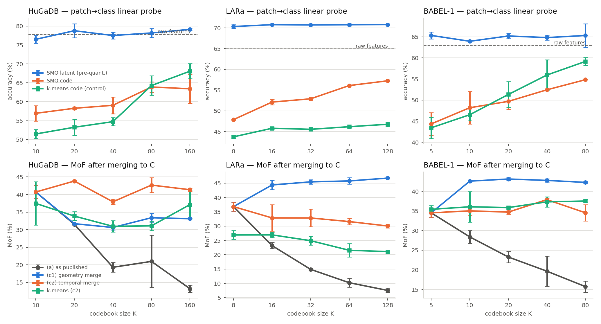
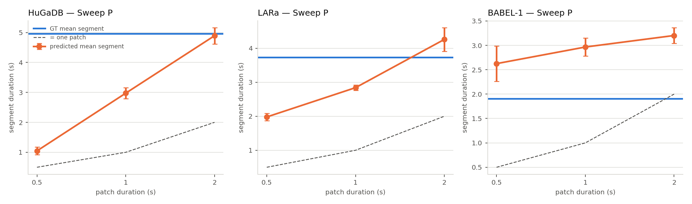

# T1–T4 results summary (auto-generated)

Generated by `script/exp/summarize.py` from `results/exp/analysis/`. Pre-registration: `results/PREREG_T1-T4.md`. Effect rule: |Δ mean| > max(sd) and mean ± sd bands do not overlap. **Deviation:** the rule was pre-registered at n = 3; T1 and T3 were concluded at n = 2 (T4 ran all 3 seeds), so their verdicts are provisional. T2 was not run — see the report.

## T1 — codebook size decoupled from class count

Mean ± sd over the seeds that ran (n per cell; T1 was concluded at 2 seeds). Verdict columns compare each K against K = C (same readout) under the effect rule; the probe verdict compares SMQ's code probe against the raw-feature k-means control at the same K.

### HuGaDB (C = 10)

| K | thr | (a) MoF | (c1) geom MoF | (c2) temp MoF | (c1) F1@50 | (c2) F1@50 | (c2) JSD | code probe | k-means code probe | latent probe | perplexity | c1 MoF vs K=C | c2 MoF vs K=C | c2 F1@50 vs K=C | probe vs k-means |
|---|---|---|---|---|---|---|---|---|---|---|---|---|---|---|---|
| 10 | 10 | 40.7 ± 1.9 (n=3) | 40.7 ± 1.9 (n=3) | 40.7 ± 1.9 (n=3) | 22.0 ± 1.8 (n=3) | 22.0 ± 1.8 (n=3) | 89.5 ± 1.5 (n=3) | 56.9 ± 2.1 (n=3) | 51.5 ± 1.2 (n=3) | 76.5 ± 1.1 (n=3) | 7.7 ± 0.3 (n=3) |  |  |  | ▲ effect |
| 20 | 5 | 31.5 ± 0.2 (n=2) | 31.7 ± 0.1 (n=2) | 43.8 ± 0.2 (n=2) | 8.8 ± 0.3 (n=2) | 25.0 ± 0.2 (n=2) | 89.2 ± 1.4 (n=2) | 58.3 ± 0.3 (n=2) | 53.3 ± 2.1 (n=3) | 78.8 ± 1.9 (n=2) | 15.6 ± 0.5 (n=2) | ▼ effect | ▲ effect | ▲ effect | ▲ effect |
| 40 | 2 | 19.3 ± 1.4 (n=2) | 30.6 ± 0.7 (n=2) | 37.9 ± 0.8 (n=2) | 7.5 ± 0.4 (n=2) | 20.1 ± 1.9 (n=2) | 88.3 ± 0.9 (n=2) | 59.1 ± 2.2 (n=2) | 54.7 ± 1.1 (n=3) | 77.5 ± 0.9 (n=2) | 30.7 ± 2.5 (n=2) | ▼ effect | ▼ effect | no effect | ▲ effect |
| 80 | 1 | 21.0 ± 7.4 (n=2) | 33.4 ± 1.2 (n=2) | 42.7 ± 2.1 (n=2) | 9.0 ± 0.1 (n=2) | 25.4 ± 1.2 (n=2) | 88.6 ± 0.7 (n=2) | 63.9 ± 1.4 (n=2) | 64.3 ± 2.6 (n=3) | 78.2 ± 1.2 (n=2) | 43.7 ± 9.7 (n=2) | ▼ effect | no effect | ▲ effect | no effect |
| 160 | 1 | 13.2 ± 1.0 (n=2) | 33.1 ± 0.1 (n=2) | 41.4 ± 0.4 (n=2) | 9.4 ± 0.1 (n=2) | 22.6 ± 2.4 (n=2) | 88.0 ± 1.0 (n=2) | 63.4 ± 3.9 (n=2) | 68.1 ± 2.0 (n=3) | 79.1 ± 0.2 (n=2) | 71.0 ± 4.0 (n=2) | ▼ effect | no effect | no effect | no effect |

Churn check (K = 160, published threshold 10, seed 1538574472): (c2) MoF 42.4, code probe 57.0, perplexity 18.3.

### LARa (C = 8)

| K | thr | (a) MoF | (c1) geom MoF | (c2) temp MoF | (c1) F1@50 | (c2) F1@50 | (c2) JSD | code probe | k-means code probe | latent probe | perplexity | c1 MoF vs K=C | c2 MoF vs K=C | c2 F1@50 vs K=C | probe vs k-means |
|---|---|---|---|---|---|---|---|---|---|---|---|---|---|---|---|
| 8 | 10 | 36.8 ± 1.5 (n=3) | 36.8 ± 1.5 (n=3) | 36.8 ± 1.5 (n=3) | 15.8 ± 0.8 (n=3) | 15.8 ± 0.8 (n=3) | 74.0 ± 0.0 (n=3) | 47.9 ± 0.1 (n=3) | 43.7 ± 0.4 (n=3) | 70.3 ± 0.4 (n=3) | 5.6 ± 0.2 (n=3) |  |  |  | ▲ effect |
| 16 | 5 | 23.2 ± 1.1 (n=2) | 44.4 ± 1.6 (n=2) | 32.9 ± 4.6 (n=2) | 16.6 ± 3.2 (n=2) | 15.6 ± 1.2 (n=2) | 74.2 ± 0.1 (n=2) | 52.1 ± 0.7 (n=2) | 45.8 ± 0.3 (n=3) | 70.8 ± 0.0 (n=2) | 12.5 ± 1.1 (n=2) | ▲ effect | no effect | no effect | ▲ effect |
| 32 | 2 | 14.9 ± 0.5 (n=2) | 45.5 ± 0.8 (n=2) | 32.8 ± 3.1 (n=2) | 12.2 ± 3.2 (n=2) | 16.8 ± 0.1 (n=2) | 74.1 ± 0.1 (n=2) | 52.9 ± 0.4 (n=2) | 45.5 ± 0.4 (n=3) | 70.7 ± 0.1 (n=2) | 25.2 ± 0.1 (n=2) | ▲ effect | no effect | ▲ effect | ▲ effect |
| 64 | 1 | 10.2 ± 1.5 (n=2) | 45.8 ± 1.1 (n=2) | 31.6 ± 1.1 (n=2) | 13.2 ± 0.9 (n=2) | 16.7 ± 0.4 (n=2) | 73.8 ± 0.5 (n=2) | 56.1 ± 0.0 (n=2) | 46.2 ± 0.2 (n=3) | 70.8 ± 0.3 (n=2) | 47.5 ± 2.3 (n=2) | ▲ effect | ▼ effect | no effect | ▲ effect |
| 128 | 1 | 7.5 ± 0.7 (n=2) | 46.8 ± 0.1 (n=2) | 30.0 ± 0.6 (n=2) | 13.2 ± 0.2 (n=2) | 16.4 ± 1.0 (n=2) | 73.9 ± 0.2 (n=2) | 57.2 ± 0.2 (n=2) | 46.8 ± 0.5 (n=3) | 70.8 ± 0.1 (n=2) | 91.9 ± 4.5 (n=2) | ▲ effect | ▼ effect | no effect | ▲ effect |

Churn check (K = 128, published threshold 10, seed 1538574472): (c2) MoF 27.8, code probe 53.3, perplexity 53.4.

### BABEL-1 (C = 5)

| K | thr | (a) MoF | (c1) geom MoF | (c2) temp MoF | (c1) F1@50 | (c2) F1@50 | (c2) JSD | code probe | k-means code probe | latent probe | perplexity | c1 MoF vs K=C | c2 MoF vs K=C | c2 F1@50 vs K=C | probe vs k-means |
|---|---|---|---|---|---|---|---|---|---|---|---|---|---|---|---|
| 5 | 10 | 34.5 ± 1.1 (n=2) | 34.5 ± 1.1 (n=2) | 34.5 ± 1.1 (n=2) | 14.7 ± 2.9 (n=2) | 14.7 ± 2.9 (n=2) | 81.4 ± 1.4 (n=2) | 44.4 ± 2.7 (n=2) | 43.4 ± 2.5 (n=3) | 65.3 ± 0.8 (n=2) | 3.6 ± 0.1 (n=2) |  |  |  | no effect |
| 10 | 5 | 28.4 ± 1.6 (n=2) | 42.6 ± 0.3 (n=2) | 35.0 ± 1.1 (n=2) | 10.7 ± 1.4 (n=2) | 16.9 ± 1.6 (n=2) | 81.7 ± 1.6 (n=2) | 48.2 ± 3.9 (n=2) | 46.5 ± 1.5 (n=3) | 63.9 ± 0.1 (n=2) | 7.5 ± 0.4 (n=2) | ▲ effect | no effect | no effect | no effect |
| 20 | 2 | 23.3 ± 1.4 (n=2) | 43.1 ± 0.3 (n=2) | 34.7 ± 0.5 (n=2) | 10.8 ± 1.3 (n=2) | 15.4 ± 1.0 (n=2) | 78.4 ± 0.0 (n=2) | 49.7 ± 1.9 (n=2) | 51.3 ± 3.1 (n=3) | 65.2 ± 0.6 (n=2) | 12.0 ± 1.3 (n=2) | ▲ effect | no effect | no effect | no effect |
| 40 | 1 | 19.7 ± 3.9 (n=2) | 42.8 ± 0.4 (n=2) | 37.9 ± 0.4 (n=2) | 15.0 ± 1.8 (n=2) | 16.8 ± 2.6 (n=2) | 80.3 ± 1.0 (n=2) | 52.4 ± 0.2 (n=2) | 55.9 ± 3.6 (n=3) | 64.8 ± 0.6 (n=2) | 21.4 ± 2.6 (n=2) | ▲ effect | ▲ effect | no effect | no effect |
| 80 | 1 | 15.7 ± 1.5 (n=2) | 42.3 ± 0.2 (n=2) | 34.5 ± 2.1 (n=2) | 12.0 ± 0.0 (n=2) | 16.7 ± 1.4 (n=2) | 81.0 ± 0.6 (n=2) | 54.8 ± 0.1 (n=2) | 59.2 ± 0.9 (n=3) | 65.3 ± 2.8 (n=2) | 40.9 ± 4.7 (n=2) | ▲ effect | no effect | no effect | ▼ effect |

Churn check (K = 80, published threshold 10, seed 1538574472): (c2) MoF 35.1, code probe 46.6, perplexity 7.1.

## T2 — temporal-consistency objective (K = C)

Baseline = T1 K = C runs (same runner). Verdicts vs baseline under the effect rule.

### HuGaDB

| condition | MoF | Edit | F1@50 | JSD | probe_code_onehot | nmi_code_vs_gt_patch | perplexity |
|---|---|---|---|---|---|---|---|
| baseline | 40.7 ± 1.9 (n=3) | 32.8 ± 3.2 (n=3) | 22.0 ± 1.8 (n=3) | 89.5 ± 1.5 (n=3) | 56.9 ± 2.1 (n=3) | 0.470 ± 0.018 (n=3) | 7.7 ± 0.3 (n=3) |
| tc1x | —  | —  | —  | —  | —  | —  | —  |
| tc10x | —  | —  | —  | —  | —  | —  | —  |
| tconly | —  | —  | —  | —  | —  | —  | —  |

### LARa

| condition | MoF | Edit | F1@50 | JSD | probe_code_onehot | nmi_code_vs_gt_patch | perplexity |
|---|---|---|---|---|---|---|---|
| baseline | 36.8 ± 1.5 (n=3) | 38.8 ± 0.9 (n=3) | 15.8 ± 0.8 (n=3) | 74.0 ± 0.0 (n=3) | 47.9 ± 0.1 (n=3) | 0.182 ± 0.005 (n=3) | 5.6 ± 0.2 (n=3) |
| tc1x | —  | —  | —  | —  | —  | —  | —  |
| tc10x | —  | —  | —  | —  | —  | —  | —  |
| tconly | —  | —  | —  | —  | —  | —  | —  |

### BABEL-1

| condition | MoF | Edit | F1@50 | JSD | probe_code_onehot | nmi_code_vs_gt_patch | perplexity |
|---|---|---|---|---|---|---|---|
| baseline | 34.5 ± 1.1 (n=2) | 28.2 ± 2.2 (n=2) | 14.7 ± 2.9 (n=2) | 81.4 ± 1.4 (n=2) | 44.4 ± 2.7 (n=2) | 0.072 ± 0.000 (n=2) | 3.6 ± 0.1 (n=2) |
| tc1x | —  | —  | —  | —  | —  | —  | —  |
| tc10x | —  | —  | —  | —  | —  | —  | —  |
| tconly | —  | —  | —  | —  | —  | —  | —  |
## T3 — duration-aware decoding (post-hoc)

Δ = decoder − argmax on the same checkpoint. Released checkpoints: single values. T1 K = C seeds: mean ± sd of the per-seed Δ; the verdict compares decoded vs argmax across the 3 seeds under the effect rule.

### HuGaDB

| decoder | source | ΔMoF | ΔEdit | ΔF1@50 | ΔJSD | segments pred/GT |
|---|---|---|---|---|---|---|
| argmax | released | (42.0) | (36.1) | (24.3) | (86.9) | 1.64 |
| hmm_beta0.5 | released | -3.6 | -19.0 | -18.5 | +11.3 | 0.23 |
| hmm_beta0.5 | T1 seeds (n=3) | -2.6 ± 0.7 no effect | -17.9 ± 3.8 ▼ effect | -17.5 ± 2.0 ▼ effect | +9.2 ± 2.2 ▼ effect | 0.33 |
| hsmm_beta0.5 | released | -5.9 | -23.1 | -21.7 | +12.7 | 0.14 |
| hsmm_beta0.5 | T1 seeds (n=3) | -2.1 ± 1.0 no effect | -22.4 ± 2.8 ▼ effect | -19.9 ± 1.5 ▼ effect | +10.2 ± 1.3 ▼ effect | 0.16 |
| hmm_beta1.0 | released | -2.5 | -15.7 | -13.5 | +8.0 | 0.55 |
| hmm_beta1.0 | T1 seeds (n=3) | -2.3 ± 0.2 no effect | -16.1 ± 3.8 ▼ effect | -14.8 ± 2.4 ▼ effect | +6.5 ± 2.2 ▼ effect | 0.74 |
| hsmm_beta1.0 | released | -4.5 | -20.5 | -17.6 | +10.8 | 0.26 |
| hsmm_beta1.0 | T1 seeds (n=3) | -2.4 ± 2.4 no effect | -20.2 ± 4.6 ▼ effect | -17.5 ± 3.4 ▼ effect | +8.3 ± 1.9 ▼ effect | 0.71 |
| hmm_beta2.0 | released | +0.9 | -3.7 | +0.3 | +4.7 | 0.95 |
| hmm_beta2.0 | T1 seeds (n=3) | +0.9 ± 1.6 no effect | -9.8 ± 3.3 ▼ effect | -6.8 ± 3.1 ▼ effect | +4.0 ± 2.3 ▼ effect | 0.98 |
| hsmm_beta2.0 | released | +0.4 | -7.0 | +2.5 | +5.8 | 0.82 |
| hsmm_beta2.0 | T1 seeds (n=3) | -0.7 ± 1.8 no effect | -12.0 ± 5.7 ▼ effect | -8.1 ± 5.4 ▼ effect | +5.0 ± 2.4 ▼ effect | 0.94 |
| hmm_beta4.0 | released | +1.5 | +0.2 | +2.7 | +2.7 | 1.19 |
| hmm_beta4.0 | T1 seeds (n=3) | +2.1 ± 0.8 no effect | -2.6 ± 1.7 no effect | +1.3 ± 0.7 no effect | +1.5 ± 1.3 no effect | 1.22 |
| hsmm_beta4.0 | released | +1.2 | +0.0 | +3.9 | +2.5 | 1.14 |
| hsmm_beta4.0 | T1 seeds (n=3) | +2.2 ± 0.9 no effect | -2.3 ± 2.7 no effect | +2.2 ± 0.2 no effect | +1.1 ± 1.1 no effect | 1.17 |

### LARa

| decoder | source | ΔMoF | ΔEdit | ΔF1@50 | ΔJSD | segments pred/GT |
|---|---|---|---|---|---|---|
| argmax | released | (37.4) | (39.4) | (16.4) | (73.9) | 1.33 |
| hmm_beta0.5 | released | +3.4 | -33.0 | -15.2 | +25.8 | 0.06 |
| hmm_beta0.5 | T1 seeds (n=3) | +3.1 ± 1.3 no effect | -32.1 ± 1.5 ▼ effect | -14.6 ± 1.0 ▼ effect | +25.7 ± 0.1 ▼ effect | 0.06 |
| hsmm_beta0.5 | released | +0.5 | -32.0 | -15.2 | +26.0 | 0.07 |
| hsmm_beta0.5 | T1 seeds (n=3) | +0.3 ± 0.7 no effect | -31.5 ± 0.7 ▼ effect | -14.6 ± 0.8 ▼ effect | +25.4 ± 0.5 ▼ effect | 0.07 |
| hmm_beta1.0 | released | +3.6 | -27.2 | -11.6 | +23.1 | 0.14 |
| hmm_beta1.0 | T1 seeds (n=3) | +3.3 ± 0.8 no effect | -26.3 ± 1.6 ▼ effect | -11.1 ± 0.8 ▼ effect | +23.0 ± 0.4 ▼ effect | 0.14 |
| hsmm_beta1.0 | released | +1.3 | -30.1 | -13.9 | +25.1 | 0.09 |
| hsmm_beta1.0 | T1 seeds (n=3) | +0.7 ± 0.5 no effect | -29.4 ± 0.8 ▼ effect | -13.3 ± 0.7 ▼ effect | +25.0 ± 0.1 ▼ effect | 0.09 |
| hmm_beta2.0 | released | +3.9 | -15.0 | -3.7 | +10.5 | 0.35 |
| hmm_beta2.0 | T1 seeds (n=3) | +3.4 ± 0.7 no effect | -14.4 ± 1.6 ▼ effect | -3.2 ± 0.6 ▼ effect | +10.4 ± 1.0 ▼ effect | 0.35 |
| hsmm_beta2.0 | released | +1.9 | -22.3 | -7.6 | +14.7 | 0.22 |
| hsmm_beta2.0 | T1 seeds (n=3) | +1.9 ± 0.5 no effect | -21.9 ± 0.9 ▼ effect | -7.2 ± 0.1 ▼ effect | +14.3 ± 0.3 ▼ effect | 0.22 |
| hmm_beta4.0 | released | +2.8 | -5.2 | +1.6 | +3.6 | 0.59 |
| hmm_beta4.0 | T1 seeds (n=3) | +2.8 ± 0.2 no effect | -4.2 ± 0.6 ▼ effect | +1.9 ± 0.4 ▲ effect | +3.3 ± 0.4 ▼ effect | 0.61 |
| hsmm_beta4.0 | released | +2.3 | -10.8 | -0.9 | +5.5 | 0.46 |
| hsmm_beta4.0 | T1 seeds (n=3) | +2.4 ± 0.3 no effect | -10.0 ± 1.5 ▼ effect | -0.2 ± 0.4 no effect | +5.3 ± 0.6 ▼ effect | 0.48 |

### BABEL-1

| decoder | source | ΔMoF | ΔEdit | ΔF1@50 | ΔJSD | segments pred/GT |
|---|---|---|---|---|---|---|
| argmax | released | (36.4) | (38.3) | (22.4) | (74.5) | 0.74 |
| hmm_beta0.5 | released | -0.8 | -19.3 | -14.9 | +18.8 | 0.20 |
| hmm_beta0.5 | T1 seeds (n=2) | +5.9 ± 1.0 ▲ effect | -8.4 ± 2.9 ▼ effect | -6.2 ± 4.6 ▼ effect | +12.0 ± 1.8 ▼ effect | 0.21 |
| hsmm_beta0.5 | released | -3.3 | -19.5 | -17.2 | +16.1 | 0.24 |
| hsmm_beta0.5 | T1 seeds (n=2) | +1.0 ± 2.6 no effect | -8.7 ± 2.3 ▼ effect | -9.4 ± 5.9 ▼ effect | +11.6 ± 1.9 ▼ effect | 0.21 |
| hmm_beta1.0 | released | -2.3 | -18.2 | -13.1 | +17.7 | 0.23 |
| hmm_beta1.0 | T1 seeds (n=2) | +4.9 ± 0.4 ▲ effect | -7.3 ± 3.6 ▼ effect | -5.1 ± 4.9 ▼ effect | +11.6 ± 1.5 ▼ effect | 0.25 |
| hsmm_beta1.0 | released | -5.9 | -19.1 | -15.4 | +14.7 | 0.30 |
| hsmm_beta1.0 | T1 seeds (n=2) | +3.7 ± 0.4 ▲ effect | -8.0 ± 2.2 ▼ effect | -5.6 ± 4.6 ▼ effect | +6.0 ± 0.6 ▼ effect | 0.32 |
| hmm_beta2.0 | released | -1.7 | -11.5 | -11.0 | +12.6 | 0.36 |
| hmm_beta2.0 | T1 seeds (n=2) | +2.2 ± 0.1 ▲ effect | -3.9 ± 4.1 no effect | -3.2 ± 4.0 no effect | +5.4 ± 0.7 ▼ effect | 0.39 |
| hsmm_beta2.0 | released | -5.5 | -9.2 | -7.9 | +8.6 | 0.43 |
| hsmm_beta2.0 | T1 seeds (n=2) | +2.1 ± 0.7 no effect | -4.5 ± 3.8 ▼ effect | -3.6 ± 4.0 no effect | +3.9 ± 1.4 no effect | 0.41 |
| hmm_beta4.0 | released | -1.3 | -10.6 | -10.2 | +10.9 | 0.41 |
| hmm_beta4.0 | T1 seeds (n=2) | +0.7 ± 0.4 no effect | -2.8 ± 3.2 no effect | -1.5 ± 2.1 no effect | +2.9 ± 0.6 no effect | 0.49 |
| hsmm_beta4.0 | released | -4.8 | -5.5 | -6.0 | +5.6 | 0.51 |
| hsmm_beta4.0 | T1 seeds (n=2) | +0.6 ± 1.0 no effect | -0.9 ± 0.1 no effect | -0.6 ± 0.3 no effect | +1.6 ± 2.1 no effect | 0.50 |
## T4 — patch duration vs frame rate

1 s @ native = T1 K = C runs. Durations in seconds; JSD at native-frame resolution. Verdicts vs the 1 s native condition.

### HuGaDB

| condition | patch (s) | fps | a_bijective.MoF | a_bijective.Edit | a_bijective.F1@50 | a_bijective.JSD | durations_s.pred_mean | durations_s.gt_mean | patch_grid_oracle.MoF | probe_code_onehot |
|---|---|---|---|---|---|---|---|---|---|---|
| P0.5s | 0.50 | 60 | 40.3 ± 2.1 (n=3) no effect | 22.1 ± 1.7 (n=3) ▼ effect | 9.3 ± 1.5 (n=3) ▼ effect | 95.1 ± 1.0 (n=3) ▼ effect | 1.05 ± 0.13 (n=3) | 4.96 ± 0.00 (n=3) | 97.8 ± 0.0 (n=3) | 57.4 ± 2.5 (n=3) no effect |
| 1s native | 1.00 | 60 | 40.7 ± 1.9 (n=3) | 32.8 ± 3.2 (n=3) | 22.0 ± 1.8 (n=3) | 89.5 ± 1.5 (n=3) | 2.97 ± 0.18 (n=3) | 4.96 ± 0.00 (n=3) | 95.5 ± 0.0 (n=3) | 56.9 ± 2.1 (n=3) |
| P2s | 2.00 | 60 | 42.6 ± 0.3 (n=3) no effect | 39.1 ± 2.7 (n=3) ▲ effect | 26.1 ± 1.5 (n=3) ▲ effect | 91.6 ± 0.3 (n=3) ▼ effect | 4.89 ± 0.27 (n=3) | 4.96 ± 0.00 (n=3) | 90.9 ± 0.0 (n=3) | 55.5 ± 1.9 (n=3) no effect |
| R2 | 1.00 | 30 | 42.3 ± 1.9 (n=3) no effect | 36.0 ± 3.1 (n=3) no effect | 24.0 ± 1.9 (n=3) no effect | 88.6 ± 1.8 (n=3) no effect | 3.17 ± 0.39 (n=3) | 4.96 ± 0.00 (n=3) | 95.5 ± 0.0 (n=3) | 58.0 ± 0.8 (n=3) no effect |
| R4 | 1.00 | 15 | 41.0 ± 1.8 (n=3) no effect | 36.6 ± 1.4 (n=3) no effect | 24.5 ± 3.4 (n=3) no effect | 88.2 ± 1.4 (n=3) no effect | 3.75 ± 0.34 (n=3) | 4.97 ± 0.00 (n=3) | 95.5 ± 0.0 (n=3) | 57.2 ± 2.2 (n=3) no effect |

### LARa

| condition | patch (s) | fps | a_bijective.MoF | a_bijective.Edit | a_bijective.F1@50 | a_bijective.JSD | durations_s.pred_mean | durations_s.gt_mean | patch_grid_oracle.MoF | probe_code_onehot |
|---|---|---|---|---|---|---|---|---|---|---|
| P0.5s | 0.50 | 50 | 35.5 ± 1.0 (n=3) no effect | 35.0 ± 1.2 (n=3) ▼ effect | 13.6 ± 0.4 (n=3) ▼ effect | 63.0 ± 0.2 (n=3) ▲ effect | 1.98 ± 0.11 (n=3) | 3.73 ± 0.00 (n=3) | 96.9 ± 0.0 (n=3) | 48.3 ± 0.3 (n=3) ▲ effect |
| 1s native | 1.00 | 50 | 36.8 ± 1.5 (n=3) | 38.8 ± 0.9 (n=3) | 15.8 ± 0.8 (n=3) | 74.0 ± 0.0 (n=3) | 2.84 ± 0.08 (n=3) | 3.73 ± 0.00 (n=3) | 93.8 ± 0.0 (n=3) | 47.9 ± 0.1 (n=3) |
| P2s | 2.00 | 50 | 30.7 ± 3.5 (n=3) ▼ effect | 35.2 ± 1.5 (n=3) ▼ effect | 14.5 ± 0.9 (n=3) no effect | 84.5 ± 0.2 (n=3) ▼ effect | 4.26 ± 0.35 (n=3) | 3.73 ± 0.00 (n=3) | 87.5 ± 0.0 (n=3) | 47.7 ± 0.3 (n=3) no effect |
| R2 | 1.00 | 25 | 35.6 ± 0.8 (n=3) no effect | 39.1 ± 1.4 (n=3) no effect | 16.1 ± 0.8 (n=3) no effect | 73.7 ± 0.2 (n=3) ▲ effect | 2.68 ± 0.07 (n=3) | 3.73 ± 0.00 (n=3) | 93.8 ± 0.0 (n=3) | 47.9 ± 0.1 (n=3) no effect |
| R5 | 1.00 | 10 | 33.2 ± 2.0 (n=3) ▼ effect | 38.5 ± 2.2 (n=3) no effect | 15.9 ± 2.0 (n=3) no effect | 73.7 ± 0.2 (n=3) ▲ effect | 2.84 ± 0.15 (n=3) | 3.73 ± 0.00 (n=3) | 93.8 ± 0.0 (n=3) | 47.8 ± 0.3 (n=3) no effect |

### BABEL-1

| condition | patch (s) | fps | a_bijective.MoF | a_bijective.Edit | a_bijective.F1@50 | a_bijective.JSD | durations_s.pred_mean | durations_s.gt_mean | patch_grid_oracle.MoF | probe_code_onehot |
|---|---|---|---|---|---|---|---|---|---|---|
| P0.5s | 0.50 | 30 | 34.8 ± 0.5 (n=3) no effect | 29.0 ± 1.4 (n=3) no effect | 12.3 ± 0.8 (n=3) no effect | 81.9 ± 2.4 (n=3) no effect | 2.62 ± 0.36 (n=3) | 1.91 ± 0.00 (n=3) | 94.9 ± 0.0 (n=3) | 45.5 ± 0.8 (n=3) no effect |
| 1s native | 1.00 | 30 | 34.5 ± 1.1 (n=2) | 28.2 ± 2.2 (n=2) | 14.7 ± 2.9 (n=2) | 81.4 ± 1.4 (n=2) | 2.97 ± 0.19 (n=2) | 1.91 ± 0.00 (n=2) | 90.2 ± 0.0 (n=2) | 44.4 ± 2.7 (n=2) |
| P2s | 2.00 | 30 | 32.0 ± 1.8 (n=3) no effect | 30.7 ± 3.8 (n=3) no effect | 14.3 ± 1.5 (n=3) no effect | 83.5 ± 0.2 (n=3) ▼ effect | 3.20 ± 0.16 (n=3) | 1.91 ± 0.00 (n=3) | 82.6 ± 0.0 (n=3) | 45.1 ± 1.3 (n=3) no effect |
| R2 | 1.00 | 15 | 32.2 ± 2.0 (n=3) no effect | 30.1 ± 3.4 (n=3) no effect | 13.3 ± 0.5 (n=3) no effect | 78.6 ± 2.7 (n=3) no effect | 2.66 ± 0.30 (n=3) | 1.92 ± 0.00 (n=3) | 90.2 ± 0.0 (n=3) | 43.5 ± 4.2 (n=3) no effect |
| R3 | 1.00 | 10 | 32.7 ± 1.5 (n=3) no effect | 28.9 ± 2.6 (n=3) no effect | 15.2 ± 2.0 (n=3) no effect | 77.4 ± 4.1 (n=3) no effect | 2.53 ± 0.27 (n=3) | 1.92 ± 0.00 (n=3) | 90.2 ± 0.0 (n=3) | 45.9 ± 0.9 (n=3) no effect |

