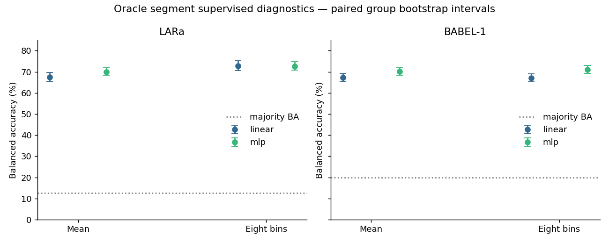
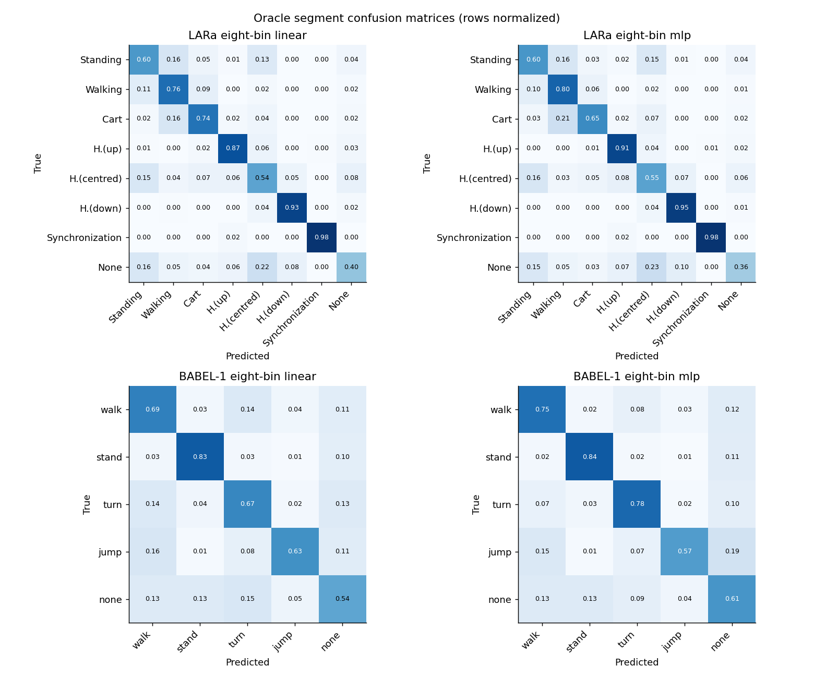
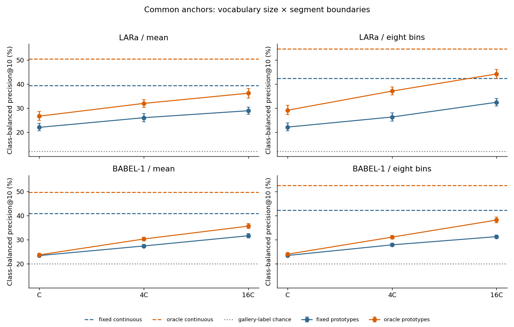
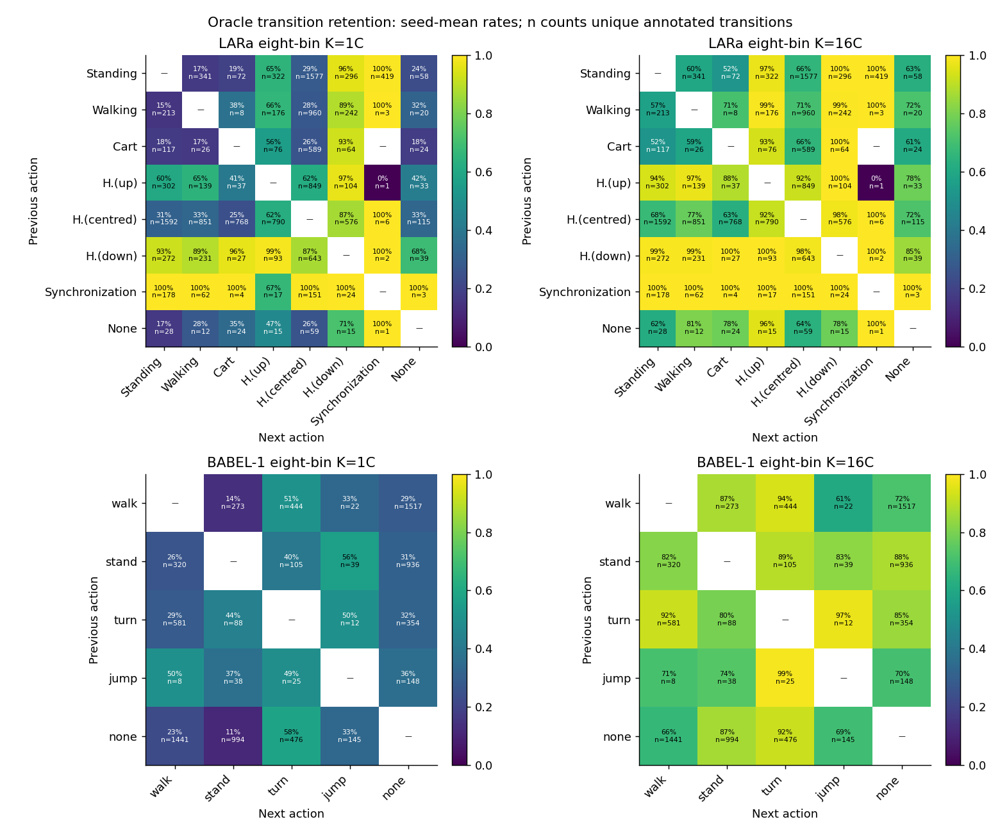
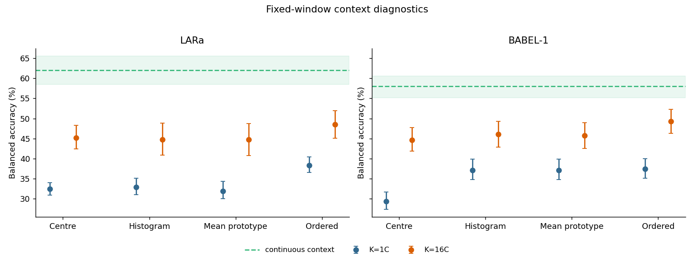

# Action vocabulary and local context: complete experiment report

This separately requested follow-up examines category collapse after [the segmentation study](../../DECISION.md). Experiment numbering is local to this report. It tests vocabulary size, Euclidean clustering geometry, weak segment features, and information accessible through neighboring codes. It concerns action-level representations; it does not test sub-action primitive discovery.

The design and numerical amendments are in [PROTOCOL.md](PROTOCOL.md), exact environment, source hashes, folds and anchors in [MANIFEST.json](MANIFEST.json), and completion checks in [VERIFICATION.json](VERIFICATION.json). Classification, retrieval and retention scores below are percentages; their differences are percentage points. Homogeneity, completeness and AMI use their usual unit scale; entropies are in nats. Bracketed ranges are paired-group bootstrap 95% intervals unless specified otherwise.

## Main findings from the primary experiments

**A coarse vocabulary is a demonstrated constraint, but enlarging it does not recover all accessible action information.** All four prespecified retrieval interactions are positive: increasing K from C to 16C enlarges the oracle-minus-fixed advantage by **2.6 [1.3, 3.9] points for LARa mean features, 4.8 [3.6, 5.8] for LARa eight-bin features, 3.7 [2.8, 4.5] for BABEL-1 mean features, and 6.3 [5.6, 7.1] for BABEL-1 eight-bin features**. This is more informative than an increase in transition retention alone.

For eight-bin oracle segments, prototype precision@10 increases **29.2% → 44.2% on LARa** and **24.0% → 38.1% on BABEL-1**. Continuous retrieval remains **54.6% and 52.4%**, respectively: the K=16C gaps are **10.3 [7.7, 12.7] and 14.3 [12.4, 16.3] points**. The quantized oracle-minus-fixed advantage reaches 11.7 points on LARa, close to the continuous 12.1-point advantage, while both absolute quantized scores remain lower. Recovering the boundary advantage is therefore different from closing the absolute quantization gap.

**The features contain substantial separable action information.** The oracle classifiers substantially exceed fitting-prior baselines. LARa benefits from eight-bin features; BABEL-1 shows a clearer eight-bin gain in macro-F1 than balanced accuracy, and benefits from the MLP. On the same oracle intervals, the continuous eight-bin linear readout exceeds the K=16C categorical linear readout by **23.0 [19.9, 25.9] BA points on LARa** and **13.7 [11.6, 15.8] on BABEL-1**. This supports a mismatch between the tested discrete partition and action distinctions accessible in the features. It does not isolate clustering geometry from remaining finite-vocabulary loss, or establish a mathematical upper bound.

**More retained transitions and more label-pure codes do not imply a clean action vocabulary.** Eight-bin oracle transition retention rises from **50.9% to 80.4% on LARa**, and **29.1% to 80.4% on BABEL-1**. LARa’s homogeneity improves while completeness falls and AMI declines approximately **0.259 → 0.237**; BABEL-1 improves both normalized consistency measures and AMI (**0.057 → 0.161**). Absolute action fragmentation, measured by H(code|label), increases as the vocabulary grows. At K=16C, **74.8% of LARa oracle queries and 95.6% of BABEL-1 oracle queries** still have at least ten eligible gallery anchors sharing their code, so prototype retrieval often measures within-code label composition. The matrices show uneven retention across action pairs; aggregate retention does not establish semantic categories.

## What local context adds

**Ordered code context exposes useful action information, but does not close the continuous-feature gap.** At K=16C, ordered context reaches **48.5% BA / 42.5% macro-F1 on LARa** and **49.3% / 43.3% on BABEL-1**. Its BA advantage over the center code is **3.2 [2.0, 4.5] points** and **4.7 [3.5, 5.8] points**, respectively. Its advantage over unordered prototype pooling is **3.8 [2.8, 4.7]** and **3.6 [2.8, 4.5] points**. Thus individual codes do not exhaust the action information accessible from their local context.

The pattern depends on vocabulary size and metric. For BABEL-1 at K=C, unordered context already adds **7.8 [6.7, 8.9] BA points** over the center code; ordering adds only **0.3 [−0.7, 1.2] BA points**, although it improves macro-F1 by **3.5 [2.7, 4.3] points**. On LARa, unordered pooling does not establish a BA gain over the center code at either K. These findings support contextual and position-sensitive information, with no uniform order-specific advantage across every endpoint. Ordered inputs have more coefficients than mean pooling and identify the center position; these comparisons do not establish hierarchical composition.

Continuous context reaches **62.0% BA / 55.3% macro-F1 on LARa** and **58.0% / 52.8% on BABEL-1** on the same eligible windows. At K=16C, its paired lead over ordered codes is **13.6 [9.3, 17.9] BA points and 12.8 [8.3, 17.7] F1 points** on LARa, and **8.7 [6.2, 11.2] BA points and 9.5 [7.6, 11.2] F1 points** on BABEL-1. These remain supervised accessibility diagnostics under the released transductive encoders. They do not establish the performance of an unsupervised action recognizer.

**Numerical sensitivity does not change that interpretation.** Eight of 567 selected linear refits reached their iteration cap. All eight were checked at fixed selected regularization against converged reference solutions. Replacing their predictions changes any affected pooled endpoint by at most **0.034 percentage points**; the positive K=16C ordered-context gains and continuous-context gaps retain positive paired intervals. The primary tables preserve the original bounded fits. Inner hyperparameter selection remains a finite-budget diagnostic, with 149 candidate fits reaching the iteration limit.


## Design and implementation assessment

| Dataset | Fixed-window tokens | Oracle intervals | Median oracle duration (s) | Recorded hours |
| --- | --- | --- | --- | --- |
| lara | 52680 | 14105 | 2.20 | 14.63 |
| babel1 | 19796 | 9926 | 1.20 | 5.26 |


- **Data and exposure:** LARa: 439 recordings, 16 participants, four participant-separated folds, C=8. BABEL-1: 1,960 recordings, five recording-separated folds, C=5. Its participant identities are unavailable. The released encoder was trained transductively on all recordings; these results are not an inductive encoder evaluation.
- **Representations:** mean latent (352/400 dimensions) and eight temporal bins (2,816/3,200 dimensions). The latter uses the preceding study’s area-average/interpolation rule. Oracle intervals use annotation boundaries and are diagnostic, not deployable segmentation. Latent receptive fields can cross those boundaries.
- **Fitting separation:** frame scaling and k-means see outer fitting recordings only. Every readout tunes regularization on a group-disjoint inner 25% split. Readout feature scalers fit inner training during tuning, then outer training for refit. The code readout conditions on an unsupervised outer-fit codebook that includes inner-validation features. No outer evaluation labels select configurations.
- **Readouts:** class-balanced L2 multinomial logistic regression (five regularization settings; float64 L-BFGS, up to 2,000 iterations, history 50) and one-hidden-layer 128-unit MLP (six decay/dropout settings, up to 60 epochs, patience 10). Both representations receive identical tuning budgets. The selected MLP epoch is refitted with three initialization seeds. These are supervised diagnostics, not unsupervised algorithms or mathematical upper bounds.
- **Numerical correction:** preliminary dense linear fits hit a 150-iteration limit with material gradients. A training-objective-only [convergence check](CONVERGENCE_PILOT.json) motivated the more accurate solver; no outer scores selected the correction. All linear diagnostics were refreshed consistently. The initial readouts are archived in `archive/fp32_150/`. Prototype readouts use orthonormal row-space coordinates internally, preserving logits and the L2 penalty; the input representation and classifier family remain the same. Projection equivalence and optimization diagnostics are audited.
- **Weighting:** main classifier and cluster analyses give each segment equal weight. Duration-weighted classifier results are separate evaluation summaries of the same trained models. Duration-weighted clustering consistency uses each segment’s majority label, which differs from the frame-label mixture for impure fixed windows. Common-anchor retrieval uses actual labels at the fixed timestamps, not majority labels.
- **Clustering:** K=C,4C,16C; seeds 0,1,2; sklearn KMeans n_init=5, max_iter=300. No Hungarian matching or reduction back to C. Original codebooks were not retained, so fitting is required for new assignments, transition metrics and context inputs; matching historical eight-bin K=C retrieval is checked in [reuse_audit.csv](reuse_audit.csv).
- **Retrieval:** identical timestamp populations across all conditions, with galleries restricted to the held-out fold and excluding the query participant (LARa) or recording (BABEL). Precision@10 uses exact expected random tie-breaking across all anchors at the cutoff. A corrected tie implementation was independently checked against 100 explicitly expanded-anchor examples. This addresses the earlier evaluator’s arbitrary cutoff selection between tied items.
- **Uncertainty:** 2,000 paired resamples of participants/recordings, shared across conditions; clustering/MLP seeds are averaged rather than counted as independent samples. Intervals condition on fitted models and fixed retrieval galleries; galleries and models are not rebuilt within each resample. Multiple endpoints are descriptive; no multiplicity-adjusted discovery claim is made.
- **Audit fix:** an initial artifact key collision overwrote per-item duration metadata with the duration confusion matrix. Raw interval durations were restored from annotations and validated; predictions and all summary scores were unaffected.

**Artifact verification:** Exp1: 36/36, Exp2: 324/324, Exp3: 225/225. Saved predictions independently reconstruct their confusion matrices; inner/outer group separation, code payload hashes, and prototype projection residuals are checked. The selected linear refits number 567; 8 reached the 2,000-iteration cap. Their largest final absolute gradient is 0.000548. Across regularization selection, 149 candidate fits reached the cap; tuning therefore remains a bounded optimization diagnostic. The audit records 8 issues in [VERIFICATION.json](VERIFICATION.json); per-fit optimization details are in [SOLVER_AUDIT.csv](SOLVER_AUDIT.csv). Independent recomputation of fitting-only frame scalers passed for all 324 clustering cells across nine folds ([SCALER_AUDIT.json](SCALER_AUDIT.json)). **Capped-fit sensitivity:** 8 selected prototype-context fits were checked at their fixed selected regularization with an independent implementation of the same objective; 8 reached a maximum gradient below 1e-8. The largest affected-fold changes were 0.2074 BA points and 0.5025 macro-F1 points; minimum prediction agreement was 98.7469%. Small systems additionally use an exact-Hessian refinement, with gradients and Hessians checked by finite differences. Primary results retain the original bounded fits. Details: [CONVERGENCE_SENSITIVITY.csv](CONVERGENCE_SENSITIVITY.csv). Replacing the flagged predictions for sensitivity changes any affected pooled seed-mean endpoint by at most 0.03386 points ([paired aggregate sensitivity](CONVERGENCE_SENSITIVITY_AGGREGATE.csv)).

**Historical reuse:** 8 of 12 matching eight-bin K=C prototype endpoints were exactly compatible and reused. The largest discrepancy among the remaining re-evaluations was 0.0234 percentage points; continuous endpoint differences were at most 0.00042 points. New assignments still required refitting because historical codebooks were not saved. Both exact tie handling and numerical/refitting differences can contribute; this audit does not isolate their causes.

## Experiment 1 — Accessible action information

**Research question:** can a small supervised diagnostic separate oracle actions from frozen segment features, and does eight-bin representation help?

Majority-class and class-prior baselines use outer fitting-segment label counts only. The prior baseline is evaluated analytically through its expected confusion matrix, avoiding additional sampling noise. Duration weighting changes evaluation weights, not the fitted baseline or classifier.



### Primary segment-weighted scores

| Dataset | Representation | Readout | Balanced accuracy | Macro-F1 |
| --- | --- | --- | --- | --- |
| lara | baseline | majority | 12.5 [12.5, 12.5] | 6.4 [6.1, 6.6] |
| lara | baseline | prior | 12.4 [12.4, 12.5] | 12.4 [12.3, 12.4] |
| lara | mean | linear | 67.5 [65.5, 69.7] | 60.8 [57.7, 63.8] |
| lara | mean | mlp | 70.0 [68.4, 72.0] | 64.6 [62.7, 66.4] |
| lara | eight | linear | 72.9 [70.6, 75.4] | 67.9 [65.8, 69.7] |
| lara | eight | mlp | 72.6 [70.8, 74.9] | 68.1 [66.0, 69.9] |
| babel1 | baseline | majority | 20.0 [20.0, 20.0] | 10.2 [10.0, 10.4] |
| babel1 | baseline | prior | 20.0 [20.0, 20.0] | 20.0 [20.0, 20.0] |
| babel1 | mean | linear | 67.3 [65.4, 69.3] | 58.5 [57.2, 60.0] |
| babel1 | mean | mlp | 70.2 [68.3, 72.1] | 63.1 [61.8, 64.5] |
| babel1 | eight | linear | 67.1 [65.2, 69.1] | 61.2 [59.7, 62.8] |
| babel1 | eight | mlp | 71.1 [69.2, 73.0] | 66.7 [65.3, 68.2] |

### Paired representation/readout differences

| Dataset | Contrast | BA difference | Macro-F1 difference |
| --- | --- | --- | --- |
| lara | eight_minus_mean_linear | 5.4 [3.7, 7.1] | 7.1 [4.1, 9.9] |
| lara | eight_minus_mean_mlp | 2.7 [1.5, 4.0] | 3.5 [2.4, 4.6] |
| lara | mlp_minus_linear_mean | 2.5 [1.3, 3.6] | 3.8 [1.8, 5.7] |
| lara | mlp_minus_linear_eight | -0.3 [-1.0, 0.5] | 0.2 [-0.5, 1.0] |
| babel1 | eight_minus_mean_linear | -0.2 [-1.7, 1.3] | 2.7 [1.5, 3.8] |
| babel1 | eight_minus_mean_mlp | 1.0 [-0.4, 2.3] | 3.6 [2.7, 4.6] |
| babel1 | mlp_minus_linear_mean | 2.9 [1.1, 4.4] | 4.5 [3.4, 5.6] |
| babel1 | mlp_minus_linear_eight | 4.0 [2.3, 5.6] | 5.5 [4.3, 6.7] |

### Duration-weighted scores (separate endpoint)

| Dataset | Representation | Readout | Balanced accuracy | Macro-F1 |
| --- | --- | --- | --- | --- |
| lara | mean | linear | 69.8 [67.3, 72.3] | 63.9 [60.7, 67.2] |
| lara | mean | mlp | 71.1 [68.8, 73.3] | 65.3 [62.4, 67.9] |
| lara | eight | linear | 72.7 [70.3, 75.0] | 68.4 [65.3, 71.0] |
| lara | eight | mlp | 72.1 [70.1, 74.0] | 67.0 [63.9, 69.7] |
| babel1 | mean | linear | 66.6 [64.1, 69.3] | 58.7 [56.5, 60.9] |
| babel1 | mean | mlp | 68.1 [65.7, 70.6] | 59.7 [57.5, 61.9] |
| babel1 | eight | linear | 65.0 [62.3, 67.6] | 58.4 [56.1, 60.7] |
| babel1 | eight | mlp | 69.5 [67.0, 72.1] | 63.4 [61.1, 65.7] |

### Class-level performance



All four readouts’ per-class recall and complete segment/duration confusion matrices are in [exp1_recalls.csv](exp1_recalls.csv) and [exp1_confusions.csv](exp1_confusions.csv). MLP confusion counts average initialization seeds and can therefore be fractional. Seed-level scores and selected hyperparameters are in [exp1_seeds.csv](exp1_seeds.csv) and [exp1_tuning.csv](exp1_tuning.csv).

**Analysis:** substantial action information is accessible in both datasets. Eight bins improve LARa BA and macro-F1; BABEL’s eight-bin macro-F1 improvement is clearer than its BA improvement. BABEL benefits from the nonlinear readout. LARa’s eight-bin MLP does not improve BA over linear. This weakens a blanket “features contain no action information” explanation, while leaving class-specific and representation limitations. Eight-bin gains combine temporal detail and higher dimension; they do not isolate temporal order. A negative MLP comparison does not establish absent information.

## Experiment 2 — Vocabulary size × meaningful boundaries

**Research question:** does expanding the vocabulary preferentially recover distinctions when segments follow actual action boundaries, or merely increase code differences and fragmentation?



### Retrieval and continuous–quantized gap

| Dataset | Features | Boundaries | Continuous | K=C | K=4C | K=16C | Continuous−16C |
| --- | --- | --- | --- | --- | --- | --- | --- |
| lara | mean | fixed | 39.4 [36.9, 41.8] | 22.1 [20.6, 23.8] | 26.1 [24.4, 27.8] | 29.0 [27.5, 30.5] | 10.4 [8.5, 12.2] |
| lara | mean | oracle | 50.5 [47.3, 53.6] | 26.7 [25.0, 28.7] | 32.0 [30.4, 33.7] | 36.2 [34.3, 38.3] | 14.2 [11.4, 17.2] |
| lara | eight | fixed | 42.5 [39.7, 44.9] | 22.2 [20.7, 23.9] | 26.4 [24.7, 28.1] | 32.5 [31.0, 34.1] | 10.0 [7.8, 11.8] |
| lara | eight | oracle | 54.6 [50.9, 58.0] | 29.2 [27.4, 31.2] | 37.1 [35.6, 38.8] | 44.2 [42.4, 46.2] | 10.3 [7.7, 12.7] |
| babel1 | mean | fixed | 40.9 [39.4, 42.6] | 23.4 [23.0, 23.7] | 27.4 [26.8, 28.1] | 31.6 [30.7, 32.6] | 9.3 [8.4, 10.3] |
| babel1 | mean | oracle | 49.7 [47.5, 52.2] | 23.7 [23.3, 24.1] | 30.3 [29.5, 31.1] | 35.6 [34.6, 36.6] | 14.1 [12.2, 16.3] |
| babel1 | eight | fixed | 42.2 [40.5, 44.0] | 23.4 [23.1, 23.8] | 27.8 [27.2, 28.5] | 31.2 [30.5, 32.0] | 10.9 [9.7, 12.3] |
| babel1 | eight | oracle | 52.4 [49.9, 55.1] | 24.0 [23.6, 24.4] | 31.0 [30.3, 31.7] | 38.1 [37.0, 39.3] | 14.3 [12.4, 16.3] |

### Primary paired interaction

| Dataset | Features | Interaction (16C gain in oracle−fixed gap) |
| --- | --- | --- |
| lara | mean | 2.6 [1.3, 3.9] |
| lara | eight | 4.8 [3.6, 5.8] |
| babel1 | mean | 3.7 [2.8, 4.5] |
| babel1 | eight | 6.3 [5.6, 7.1] |

The paired oracle−fixed contrasts at each K and K=16C−C gains within each boundary condition are in [exp2_paired.csv](exp2_paired.csv).

### Oracle transition preservation and vocabulary occupancy

| Dataset | Features | K/C | Overall retention | Macro-type retention | Occupied K | Effective K |
| --- | --- | --- | --- | --- | --- | --- |
| lara | mean | 1 | 52.5 [48.3, 56.3] | 61.9 [59.0, 65.2] | 8.0 | 5.7 |
| lara | mean | 4 | 70.1 [66.7, 73.6] | 78.3 [75.9, 80.2] | 30.6 | 18.3 |
| lara | mean | 16 | 80.1 [78.1, 82.0] | 84.9 [83.4, 86.0] | 109.0 | 55.6 |
| lara | eight | 1 | 50.9 [46.6, 55.3] | 60.0 [57.5, 63.6] | 8.0 | 5.4 |
| lara | eight | 4 | 69.7 [66.2, 73.0] | 75.7 [74.2, 78.0] | 30.9 | 18.5 |
| lara | eight | 16 | 80.4 [78.2, 82.3] | 83.5 [82.1, 85.8] | 110.9 | 56.7 |
| babel1 | mean | 1 | 23.8 [22.5, 24.9] | 32.7 [28.6, 36.4] | 5.0 | 2.9 |
| babel1 | mean | 4 | 54.3 [52.8, 55.9] | 57.3 [53.8, 60.7] | 19.9 | 9.2 |
| babel1 | mean | 16 | 77.5 [76.3, 78.7] | 79.3 [76.5, 82.0] | 71.7 | 36.3 |
| babel1 | eight | 1 | 29.1 [27.9, 30.3] | 36.6 [32.5, 40.3] | 5.0 | 3.1 |
| babel1 | eight | 4 | 63.8 [62.2, 65.4] | 65.5 [62.1, 68.5] | 19.9 | 11.5 |
| babel1 | eight | 16 | 80.4 [79.0, 81.6] | 81.8 [78.8, 84.6] | 74.5 | 37.6 |



Transition matrices give retained/collapsed counts for every ordered action-label pair, separately by seed: [exp2_transitions.csv](exp2_transitions.csv). The figure shows the eight-bin endpoint vocabulary sizes; n is the number of unique annotated transitions, not the count multiplied by seeds. Occupancy and effective vocabulary average within-fold quantities; cluster identities are never pooled across codebooks. Higher transition retention alone is insufficient: increasing K makes distinct neighboring codes more likely even without semantic improvement.

### Label consistency, fragmentation, transfer, and same-code saturation

| Dataset | Features | Bounds | K/C | Homogeneity | Completeness | AMI | Code BA | Code macro-F1 | Recalled classes (pooled / fold mean) | ≥10 same-code (%) |
| --- | --- | --- | --- | --- | --- | --- | --- | --- | --- | --- |
| lara | mean | fixed | 1 | 0.175 | 0.184 | 0.178 | 32.3 [30.9, 33.7] | 21.7 [18.9, 23.8] | 7.3 / 5.3 | 100.0 |
| lara | mean | fixed | 4 | 0.248 | 0.147 | 0.181 | 37.6 [35.4, 40.0] | 31.2 [29.0, 33.1] | 8.0 / 8.0 | 91.3 |
| lara | mean | fixed | 16 | 0.328 | 0.135 | 0.183 | 41.5 [39.3, 43.8] | 34.4 [32.4, 36.3] | 8.0 / 8.0 | 80.1 |
| lara | mean | oracle | 1 | 0.240 | 0.249 | 0.241 | 34.8 [32.0, 37.3] | 29.6 [26.0, 32.1] | 8.0 / 6.0 | 100.0 |
| lara | mean | oracle | 4 | 0.330 | 0.203 | 0.241 | 43.6 [40.8, 46.5] | 34.4 [31.6, 36.6] | 8.0 / 7.3 | 91.9 |
| lara | mean | oracle | 16 | 0.405 | 0.179 | 0.220 | 46.5 [44.6, 48.5] | 39.1 [37.6, 40.7] | 8.0 / 8.0 | 73.1 |
| lara | eight | fixed | 1 | 0.174 | 0.185 | 0.178 | 32.6 [31.4, 33.8] | 22.2 [19.6, 24.0] | 7.7 / 5.5 | 100.0 |
| lara | eight | fixed | 4 | 0.252 | 0.150 | 0.185 | 38.6 [36.6, 40.7] | 31.6 [29.6, 33.3] | 8.0 / 8.0 | 92.6 |
| lara | eight | fixed | 16 | 0.345 | 0.143 | 0.193 | 45.9 [43.2, 48.7] | 40.5 [38.4, 42.5] | 8.0 / 8.0 | 80.7 |
| lara | eight | oracle | 1 | 0.255 | 0.270 | 0.259 | 37.1 [35.0, 39.1] | 30.7 [28.2, 32.4] | 8.0 / 5.6 | 100.0 |
| lara | eight | oracle | 4 | 0.358 | 0.219 | 0.262 | 46.7 [44.5, 49.0] | 40.6 [38.1, 42.4] | 8.0 / 7.5 | 92.4 |
| lara | eight | oracle | 16 | 0.435 | 0.191 | 0.237 | 49.9 [48.1, 52.2] | 46.0 [44.4, 47.5] | 8.0 / 8.0 | 74.8 |
| babel1 | mean | fixed | 1 | 0.063 | 0.076 | 0.068 | 31.2 [29.6, 33.0] | 20.6 [19.6, 21.6] | 4.0 / 4.0 | 100.0 |
| babel1 | mean | fixed | 4 | 0.146 | 0.085 | 0.103 | 41.6 [39.4, 43.8] | 27.6 [26.5, 28.8] | 5.0 / 4.5 | 99.6 |
| babel1 | mean | fixed | 16 | 0.255 | 0.094 | 0.124 | 48.0 [45.9, 50.3] | 39.2 [37.8, 40.7] | 5.0 / 5.0 | 95.7 |
| babel1 | mean | oracle | 1 | 0.047 | 0.062 | 0.050 | 34.2 [32.5, 36.1] | 17.5 [16.8, 18.3] | 3.0 / 3.0 | 100.0 |
| babel1 | mean | oracle | 4 | 0.148 | 0.093 | 0.104 | 44.2 [42.3, 46.1] | 31.9 [30.8, 33.0] | 5.0 / 5.0 | 99.6 |
| babel1 | mean | oracle | 16 | 0.288 | 0.112 | 0.136 | 50.9 [48.9, 52.9] | 41.0 [40.0, 42.2] | 5.0 / 5.0 | 95.1 |
| babel1 | eight | fixed | 1 | 0.064 | 0.076 | 0.068 | 31.3 [29.7, 33.2] | 20.6 [19.6, 21.6] | 4.0 / 4.0 | 100.0 |
| babel1 | eight | fixed | 4 | 0.157 | 0.086 | 0.107 | 42.5 [40.3, 44.7] | 32.5 [31.3, 33.8] | 5.0 / 4.8 | 99.7 |
| babel1 | eight | fixed | 16 | 0.254 | 0.093 | 0.123 | 47.1 [44.8, 49.5] | 38.9 [37.5, 40.2] | 5.0 / 5.0 | 96.1 |
| babel1 | eight | oracle | 1 | 0.055 | 0.067 | 0.057 | 34.7 [32.9, 36.6] | 22.6 [21.8, 23.5] | 4.0 / 3.3 | 100.0 |
| babel1 | eight | oracle | 4 | 0.190 | 0.108 | 0.129 | 47.9 [46.0, 49.8] | 36.8 [35.7, 37.9] | 5.0 / 5.0 | 99.7 |
| babel1 | eight | oracle | 16 | 0.335 | 0.129 | 0.161 | 53.4 [51.5, 55.4] | 43.9 [42.9, 45.0] | 5.0 / 5.0 | 95.6 |

Code-to-label transfer is supervised evaluation of an unsupervised vocabulary. Class coverage includes both predicted and correctly recalled classes in [exp2_seeds.csv](exp2_seeds.csv); the table shows recalled classes. That file also gives H(label|code), H(code|label) in nats, purity, occupied/effective K and seed-specific results; [exp2_folds.csv](exp2_folds.csv) retains each outer fold. Higher homogeneity/purity must be read alongside fragmentation (lower completeness/higher H(code|label)) and AMI. Same-code saturation is the fraction of all query anchors with at least ten eligible gallery anchors sharing their code; high saturation means retrieval largely measures within-code label composition.

### Secondary paired readout gap on identical oracle intervals

| Dataset | Features | Continuous linear − code linear BA (K=16C) | Macro-F1 difference |
| --- | --- | --- | --- |
| lara | mean | 20.9 [18.4, 23.7] | 21.7 [18.7, 24.9] |
| lara | eight | 23.0 [19.9, 25.9] | 21.9 [18.8, 24.7] |
| babel1 | mean | 16.5 [14.5, 18.4] | 17.5 [16.3, 18.8] |
| babel1 | eight | 13.7 [11.6, 15.8] | 17.3 [16.1, 18.6] |

These explanatory comparisons quantify the diagnostic reference after the primary analysis; they were not extra primary endpoints. Both sides predict the same oracle-segment labels, with the same class-balanced linear family and nested regularization grid. Continuous inputs receive fitting-only feature standardization; categorical inputs retain their one-hot scale. The full comparison at every K is in [oracle_readout_gap.csv](oracle_readout_gap.csv).

## Experiment 3 — Fixed-window local context

**Research question:** do five-window code contexts expose useful action information beyond a centre code, and does ordered context improve over unordered context? This experiment began only after both primary experiments completed. No oracle boundaries are used.

Only the prespecified eight-bin representation and K=C,16C are used. Predict the centre window’s existing majority label. Two neighboring tokens on each side are required within the same recording; the existing final partial window is retained as a valid token. All compared inputs use identical eligible centers.



Error bars and the continuous-reference bands show 95% group-bootstrap intervals. Paired differences below use the shared bootstrap draws.

| Dataset | K/C | Input | Input dimensions | Nominal coefficients | Solver dims / coefficients | BA | Macro-F1 |
| --- | --- | --- | --- | --- | --- | --- | --- |
| lara | 1 | center | 8 | 72 | 8 / 72 | 32.5 [30.8, 34.0] | 21.3 [18.9, 23.0] |
| lara | 1 | histogram | 8 | 72 | 8 / 72 | 32.8 [31.0, 35.1] | 23.3 [21.3, 24.6] |
| lara | 1 | unordered | 2816 | 22536 | 8 / 72 | 31.8 [29.9, 34.3] | 22.4 [20.2, 24.2] |
| lara | 1 | ordered | 14080 | 112648 | 40 / 328 | 38.3 [36.5, 40.4] | 27.9 [25.6, 29.9] |
| lara | 16 | center | 128 | 1032 | 128 / 1032 | 45.2 [42.4, 48.2] | 38.8 [36.4, 40.9] |
| lara | 16 | histogram | 128 | 1032 | 128 / 1032 | 44.7 [40.8, 48.8] | 36.1 [33.0, 39.1] |
| lara | 16 | unordered | 2816 | 22536 | 128 / 1032 | 44.7 [40.7, 48.7] | 37.0 [33.9, 39.9] |
| lara | 16 | ordered | 14080 | 112648 | 640 / 5128 | 48.5 [45.1, 52.0] | 42.5 [39.6, 45.1] |
| lara | — | continuous | 14080 | 112648 | 14080 / 112648 | 62.0 [58.5, 65.5] | 55.3 [51.2, 58.8] |
| babel1 | 1 | center | 5 | 30 | 5 / 30 | 29.4 [27.3, 31.7] | 16.8 [15.2, 18.7] |
| babel1 | 1 | histogram | 5 | 30 | 5 / 30 | 37.1 [34.8, 39.9] | 23.1 [21.4, 24.8] |
| babel1 | 1 | unordered | 3200 | 16005 | 5 / 30 | 37.1 [34.7, 39.9] | 24.3 [22.6, 26.1] |
| babel1 | 1 | ordered | 16000 | 80005 | 25 / 130 | 37.4 [35.1, 40.0] | 27.8 [26.2, 29.5] |
| babel1 | 16 | center | 80 | 405 | 80 / 405 | 44.7 [41.9, 47.7] | 37.8 [35.9, 39.7] |
| babel1 | 16 | histogram | 80 | 405 | 80 / 405 | 46.1 [42.9, 49.3] | 39.1 [36.9, 41.3] |
| babel1 | 16 | unordered | 3200 | 16005 | 80 / 405 | 45.7 [42.6, 48.9] | 39.3 [37.2, 41.5] |
| babel1 | 16 | ordered | 16000 | 80005 | 400 / 2005 | 49.3 [46.3, 52.3] | 43.3 [41.3, 45.5] |
| babel1 | — | continuous | 16000 | 80005 | 16000 / 80005 | 58.0 [55.2, 60.6] | 52.8 [50.1, 55.1] |

Centre code and histogram use one-hot/category dimensions. Mean and ordered inputs use fixed-dimensional cluster prototypes; continuous context concatenates the original vectors for those same five windows. All use the same regularized linear family and tuning grid. Ordered and continuous inputs have five times the dimension of mean prototype pooling, so parameter counts differ: the shared family does not fully eliminate capacity as an explanation. Histogram is secondary.

| Dataset | K/C | Contrast | BA difference | Macro-F1 difference |
| --- | --- | --- | --- | --- |
| lara | 1 | ordered_minus_unordered | 6.5 [5.2, 7.7] | 5.5 [4.2, 6.8] |
| lara | 1 | ordered_minus_center | 5.9 [4.0, 7.8] | 6.6 [5.0, 8.5] |
| lara | 1 | unordered_minus_center | -0.6 [-2.4, 1.4] | 1.1 [-0.8, 3.4] |
| lara | 1 | continuous_minus_ordered | 23.7 [20.6, 26.7] | 27.4 [23.8, 30.9] |
| lara | 16 | ordered_minus_unordered | 3.8 [2.8, 4.7] | 5.5 [4.8, 6.1] |
| lara | 16 | ordered_minus_center | 3.2 [2.0, 4.5] | 3.7 [2.1, 5.2] |
| lara | 16 | unordered_minus_center | -0.5 [-2.4, 1.2] | -1.8 [-3.7, -0.1] |
| lara | 16 | continuous_minus_ordered | 13.6 [9.3, 17.9] | 12.8 [8.3, 17.7] |
| babel1 | 1 | ordered_minus_unordered | 0.3 [-0.7, 1.2] | 3.5 [2.7, 4.3] |
| babel1 | 1 | ordered_minus_center | 8.0 [6.8, 9.3] | 11.0 [9.8, 12.1] |
| babel1 | 1 | unordered_minus_center | 7.8 [6.7, 8.9] | 7.5 [6.6, 8.3] |
| babel1 | 1 | continuous_minus_ordered | 20.7 [17.7, 23.2] | 25.0 [22.7, 27.1] |
| babel1 | 16 | ordered_minus_unordered | 3.6 [2.8, 4.5] | 4.0 [3.3, 4.7] |
| babel1 | 16 | ordered_minus_center | 4.7 [3.5, 5.8] | 5.6 [4.7, 6.5] |
| babel1 | 16 | unordered_minus_center | 1.0 [-0.4, 2.4] | 1.6 [0.4, 2.7] |
| babel1 | 16 | continuous_minus_ordered | 8.7 [6.2, 11.2] | 9.5 [7.6, 11.2] |

All histogram contrasts are included in [exp3_paired.csv](exp3_paired.csv). Coverage, selected regularization and nominal parameter counts by fold/seed are in [exp3_parameters.csv](exp3_parameters.csv); seed-level performance is in [exp3_seeds.csv](exp3_seeds.csv). Confusions are in [exp3_confusions.csv](exp3_confusions.csv). Prototype inputs occupy a lower-rank subspace, so nominal parameter counts do not fully describe effective capacity. Unordered pooling retains the within-window representation; the order comparison concerns positions across windows. The linear readouts test additive context, not nonlinear motifs. These endpoints measure action-label accessibility, not hierarchical composition or discovered primitives.

| Dataset | Eligible centre windows | All fixed windows | Retained (%) | Mean centre purity |
| --- | --- | --- | --- | --- |
| lara | 50924 | 52680 | 96.7 | 0.939 |
| babel1 | 11990 | 19796 | 60.6 | 0.917 |


The eligibility restriction retains 96.7% of LARa and 60.6% of BABEL-1 windows. Context scores should therefore not be compared directly with full-population Exp2 classifier scores. As a descriptive label-persistence check, all five windows have the same majority label in 38.1% and 33.9% of eligible cases, respectively ([CONTEXT_POPULATION.json](CONTEXT_POPULATION.json)). Ordered concatenation identifies the center position and allows position-specific weights; gains over a mean can reflect these properties as well as temporal relationships. They do not isolate learned composition, and label persistence remains a possible source of context benefits.

### Numerical sensitivity of capped selected fits

| Dataset | K/C | Input | Primary / refined BA | Primary / refined macro-F1 | BA change | F1 change |
| --- | --- | --- | --- | --- | --- | --- |
| babel1 | 16 | ordered | 49.307 / 49.322 | 43.345 / 43.379 | +0.0147 | +0.0339 |
| babel1 | 16 | unordered | 45.694 / 45.695 | 39.324 / 39.326 | +0.0013 | +0.0022 |
| lara | 1 | ordered | 38.313 / 38.314 | 27.891 / 27.891 | +0.0010 | +0.0006 |
| lara | 16 | unordered | 44.683 / 44.681 | 36.986 / 36.984 | -0.0026 | -0.0013 |

Only the flagged selected refits are replaced in this sensitivity; their regularization choices are fixed, and the original bounded inner selection remains. Original results above remain the primary estimates. All paired context contrasts are recomputed with the same bootstrap draws in [CONVERGENCE_SENSITIVITY_PAIRED.csv](CONVERGENCE_SENSITIVITY_PAIRED.csv). This checks the numerical stability of the research interpretation without choosing results based on outer scores.

## Appendix — per-class recall (segment-weighted)

| Dataset | Action | Mean linear | Mean MLP | Eight-bin linear | Eight-bin MLP |
| --- | --- | --- | --- | --- | --- |
| lara | Standing | 54.9 | 58.4 | 59.7 | 60.3 |
| lara | Walking | 72.3 | 77.3 | 76.4 | 80.2 |
| lara | Cart | 72.6 | 63.4 | 74.1 | 65.1 |
| lara | Handling(upwards) | 75.4 | 86.0 | 87.4 | 91.1 |
| lara | Handling(centred) | 44.1 | 49.7 | 54.5 | 55.2 |
| lara | Handling(downwards) | 89.8 | 93.9 | 92.5 | 94.6 |
| lara | Synchronization | 92.5 | 94.7 | 98.4 | 98.3 |
| lara | None | 38.3 | 36.4 | 40.0 | 36.2 |
| babel1 | walk | 70.8 | 73.1 | 68.8 | 75.2 |
| babel1 | stand | 86.0 | 83.3 | 83.4 | 84.0 |
| babel1 | turn | 71.1 | 76.5 | 66.7 | 78.2 |
| babel1 | jump | 68.6 | 64.2 | 62.9 | 57.5 |
| babel1 | none | 40.1 | 53.7 | 53.7 | 60.7 |


## Reproduction and artifact index

Run from the repository root with the existing `smq` environment. Each training script saves completed cells atomically and skips them on resume. Exp3 checks primary completion before fitting. The environment variable below sets a fresh execution deadline for a later reproduction; this run used its original absolute deadline. To refit instead of resume, archive the existing `results/vocab/exp1`, `exp2`, `exp3`, and `convergence_sensitivity` directories first.

```powershell
$env:SMQ_VOCAB_DEADLINE = [DateTimeOffset]::UtcNow.AddHours(7.2).ToUnixTimeSeconds()
& 'C:/Users/gzaz976/AppData/Local/anaconda3/envs/smq/python.exe' -B script/vocab/run_exp1.py
& 'C:/Users/gzaz976/AppData/Local/anaconda3/envs/smq/python.exe' -B script/vocab/run_exp2.py
& 'C:/Users/gzaz976/AppData/Local/anaconda3/envs/smq/python.exe' -B script/vocab/run_exp3.py
& 'C:/Users/gzaz976/AppData/Local/anaconda3/envs/smq/python.exe' -B script/vocab/analyze.py
& 'C:/Users/gzaz976/AppData/Local/anaconda3/envs/smq/python.exe' -B script/vocab/compare_readouts.py
& 'C:/Users/gzaz976/AppData/Local/anaconda3/envs/smq/python.exe' -B script/vocab/convergence_sensitivity.py
& 'C:/Users/gzaz976/AppData/Local/anaconda3/envs/smq/python.exe' -B script/vocab/verify.py --complete
& 'C:/Users/gzaz976/AppData/Local/anaconda3/envs/smq/python.exe' -B script/vocab/report.py
```

Saved fold artifacts in `exp1/`, `exp2/`, `exp3/` contain evaluation predictions/confusions and selected tuning configurations. Exp2 additionally saves codebooks, assignments, scalers and transition counts. Logs include the initial [exp1.log](exp1.log) and [exp2.log](exp2.log), corrected [exp1_refit.log](exp1_refit.log) and [code_readout_refit.log](code_readout_refit.log), per-fold `exp2_<dataset>_f<fold>.log` and `exp3_<dataset>_f<fold>.log`, and the initial [exp3.log](exp3.log). Analysis tables retain more precision than displayed. Historical root reports and model files were not changed by this run.

## Research decision

Evidence comes from all three completed experiments, with the original bounded readouts and the converged-fit sensitivity giving the same decision. Differences below are percentage points; bracketed ranges are paired 95% group-bootstrap intervals.

| Explanation | Supporting result | Contradicting or limiting result | Remaining uncertainty |
| --- | --- | --- | --- |
| Vocabulary too coarse | Every prespecified retrieval interaction is positive. For eight-bin features, enlarging K from C to 16C increases the oracle-minus-fixed advantage by 4.8 [3.6, 5.8] points on LARa and 6.3 [5.6, 7.1] on BABEL-1. | At 16C, oracle prototype retrieval still trails continuous retrieval by 10.3 and 14.3 points. Fragmentation increases; LARa AMI decreases despite higher homogeneity. | Coarse vocabulary is a demonstrated partial explanation. K beyond 16C and other quantizers were not tested; retained transitions are not evidence of semantic categories by themselves. |
| Clustering geometry unsuitable | Oracle linear readouts reach 72.9% BA on LARa and 67.1% on BABEL-1 with eight bins. They exceed 16C categorical readouts by 23.0 [19.9, 25.9] and 13.7 [11.6, 15.8] points. BABEL-1 also benefits from the MLP. | Enlarging K substantially improves retrieval, so a pure geometry explanation cannot account for everything. | Accessible action distinctions are poorly preserved by the tested partition, but geometry is not causally isolated from finite K, regularization, representation structure, or labels. No alternative geometry was compared. |
| Segment representation weak | Classification remains imperfect and class-dependent; some actions and background remain difficult. | Both diagnostic families substantially exceed fitting-prior baselines. Eight-bin oracle BA is roughly 71–73% with the MLP, and continuous retrieval/context consistently exceed the tested quantized counterparts. | A blanket absence-of-action-information explanation is contradicted. Residual errors can also reflect labels or diagnostic training. These finite diagnostics are not upper bounds, and the encoders are transductive. |
| Information distributed across code sequences | At 16C, ordered context beats the center code by 3.2 [2.0, 4.5] BA points on LARa and 4.7 [3.5, 5.8] on BABEL-1; it also beats unordered pooling on both datasets. | Continuous context still leads by 13.6 [9.3, 17.9] and 8.7 [6.2, 11.2] BA points. BABEL-1 at C shows a contextual BA gain without a clear extra ordering gain. | Useful local, position-sensitive information is supported. Greater capacity, center-position access and label persistence remain alternative explanations for ordering gains. This is not evidence of hierarchy or primitive discovery. |

**Recommended next direction: Retain continuous representations because the tested discrete bottleneck offers no demonstrated benefit on the evaluated action endpoints.**

Use the continuous representation as the basis for the remaining submission work. Larger vocabularies and ordered contexts explain part of the failure of coarse individual codes, but neither recovers the continuous reference on retrieval or context classification. This recommendation concerns the tested frozen-feature, Euclidean k-means pipeline. Compression, interpretability and other possible benefits of discretization were not measured, so the conclusion is limited to the evaluated action tasks.

